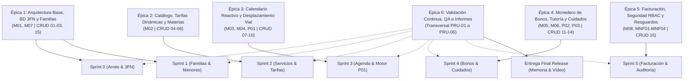

# EduCare Kids - Sistema Integral de Gestión de Centro Infantil y Pedagógico
## Backlog Maestro de Jira Cloud: Desglose Oficial por Sprints, Épicas y Trazabilidad BDD

> **Proyecto:** EduCare Kids (Gestión de Centro Infantil, Niñera a Domicilio, Clases de Apoyo y Tutoría Asíncrona)  
> **Asignatura / Marco:** Proyecto de Ingeniería de Software (Metodología Solo-Scrum)  
> **Arquitectura:** 3 Capas (Frontend React/Next.js, Backend Node.js/TypeScript, Persistencia SQLite en Tercera Forma Normal - 3FN)  
> **Total de Sprints:** 7 Sprints (Sprint 0 al Sprint 5 + Entrega Final Release)  
> **Velocidad Total:** 94 Story Points  

---

## 📌 Índice de Documentos por Sprint

A continuación se presentan los enlaces directos a los documentos técnicos individuales de cada sprint, estructurados con toda su información oficial (épicas, historias de usuario, subtareas CRUD, planes de prueba de la matriz y validaciones en nomenclatura BDD Gherkin):

| Documento | Sprint | Período de Ejecución | Story Points | Foco Principal | Enlace Directo |
| :--- | :--- | :---: | :---: | :--- | :---: |
| 📘 `Sprint_0.md` | **Sprint 0** | 04/11/2026 – 11/11/2026 | **9 SP** | Arquitectura Base en 3 capas, esquema relacional 3FN (16 tablas), configuración de sede y arnés Jest/Vitest. | [Ver Sprint 0](./Sprint_0.md) |
| 📘 `Sprint_1.md` | **Sprint 1** | 12/11/2026 – 25/11/2026 | **14 SP** | Gestión de familias (CRUD 01), expedientes de menores (CRUD 02) y alérgenos/pautas médicas (CRUD 03). | [Ver Sprint 1](./Sprint_1.md) |
| 📘 `Sprint_2.md` | **Sprint 2** | 26/11/2026 – 09/12/2026 | **14 SP** | Catálogo de servicios (CRUD 04), motor de tarifas por edad (+30% / +15%) (CRUD 05) y materias de apoyo (CRUD 06). | [Ver Sprint 2](./Sprint_2.md) |
| 📘 `Sprint_3.md` | **Sprint 3** | 10/12/2026 – 23/12/2026 | **15 SP** | Calendario reactivo (CRUD 07-08), zonas viales (CRUD 09) y motor autónomo P01 (radio 25 km y bloqueos 20 min en CRUD 10). | [Ver Sprint 3](./Sprint_3.md) |
| 📘 `Sprint_4.md` | **Sprint 4** | 24/12/2026 – 06/01/2027 | **15 SP** | Monedero de bonos prepago (CRUD 11-12) con P02 y alerta P03 (<=2h), buzón asíncrono (CRUD 13) y diario de cuidados (CRUD 14). | [Ver Sprint 4](./Sprint_4.md) |
| 📘 `Sprint_5.md` | **Sprint 5** | 07/01/2027 – 20/01/2027 | **14 SP** | Facturación familiar (CRUD 16), seguridad RBAC (MNF01), logs de auditoría (MNF02), resguardos SQLite (MNF03) y regresión final. | [Ver Sprint 5](./Sprint_5.md) |
| 📕 `Sprint_Entrega_Final.md` | **Entrega Final (Release)** | 21/01/2027 – 03/02/2027 | **13 SP** | Memoria técnica definitiva en 3FN, grabación de vídeo demostrativo, checklist VIU y empaquetado oficial. | [Ver Entrega Final](./Sprint_Entrega_Final.md) |

---

## 🗺️ Mapa de Épicas del Product Backlog

El proyecto se estructura en 6 grandes Épicas que agrupan los 16 CRUDs funcionales y los 4 módulos no funcionales:

### Detalle de las 6 Épicas Oficiales:
1. **Épica 1 (ID 1):** *EP01: Arquitectura Base, Base de Datos 3FN y Gestión de Familias (M01, M07)*  
   Diseño e implementación de la arquitectura en 3 capas, modelado de las 16 entidades en 3FN sobre SQLite, configuración de sede central (CRUD 15) y módulo completo de alta de familias, menores y alérgenos (CRUD 01 a 03).
2. **Épica 2 (ID 2):** *EP02: Catálogo de Servicios, Tarifas Dinámicas por Edad y Materias (M02)*  
   Catálogo de 4 modalidades de servicio, motor de recargo dinámico (+30% 0-2 años, +15% 3-5 años) y catálogo de materias escolares (CRUD 04 a 06).
3. **Épica 3 (ID 3):** *EP03: Calendario Reactivo, Reservas y Motor Autónomo de Desplazamiento Vial (M03, M04, P01)*  
   Calendario interactivo, franjas horarias (CRUD 07-08), zonas viales y motor autónomo P01 (radio <=25 km y bloqueo de 20 min previos y posteriores en CRUD 09-10).
4. **Épica 4 (ID 4):** *EP04: Monedero de Bonos Prepago, Tutoría Asíncrona y Diario de Cuidados (M05, M06, P02, P03)*  
   Catálogo de bonos y saldos familiares (CRUD 11-12), procesos autónomos de débito (P02) y alerta saldo <=2h (P03), buzón de tutoría asíncrona (CRUD 13) y diario de cuidados (CRUD 14).
5. **Épica 5 (ID 5):** *EP05: Facturación, Analítica, Seguridad RBAC, Auditoría y Resguardos (M08, MNF01..MNF04)*  
   Facturación desglosada y analítica (CRUD 16), control de acceso por roles RBAC Padres/Administrador (MNF01), logs de auditoría (MNF02), copias de seguridad de SQLite (MNF03) y diseño adaptativo (MNF04).
6. **Épica 6 (ID 6):** *Plan de Validación Continua por Sprint, Calidad (QA), Informes y Entrega Final*  
   Épica transversal que garantiza la calidad mediante pruebas automatizadas con Jest/Vitest (PRU-01 a PRU-06), informes quincenales por sprint y la consolidación de la memoria técnica y vídeo final.

---

## 📊 Matriz de Cobertura y Trazabilidad Integral

| Módulo / Requisito | Entidad / CRUD | Sprint de Entrega | Tipo de Prueba | Validación BDD (Gherkin) |
| :--- | :--- | :---: | :---: | :---: |
| **M07 - Configuración** | CRUD 15 (`configuracion_sede`) | **Sprint 0** | PRU-02 | Parametrización de sede y radio 25 km |
| **M01 - Familias** | CRUD 01 (`familias`) | **Sprint 1** | PRU-02, PRU-03 | Validación de dirección y radio presencial |
| **M01 - Menores** | CRUD 02 (`menores`) | **Sprint 1** | PRU-01, PRU-02 | Cálculo dinámico de edad en años/meses |
| **M01 - Alérgenos** | CRUD 03 (`alergenos_menores`) | **Sprint 1** | PRU-02 | Asociación relacional sin registros huérfanos |
| **M02 - Catálogo** | CRUD 04 (`servicios`) | **Sprint 2** | PRU-02 | Alta de 4 modalidades operativas |
| **M02 - Tarifas** | CRUD 05 (`tarifas_edad`) | **Sprint 2** | PRU-01 | Recargos automáticos +30% y +15% |
| **M02 - Materias** | CRUD 06 (`materias_apoyo`) | **Sprint 2** | PRU-02 | Selección de asignaturas por etapa educativa |
| **M03 - Reservas** | CRUD 07 (`citas`) | **Sprint 3** | PRU-04, PRU-06 | Detección y bloqueo de solapamiento de agenda |
| **M03 - Franjas** | CRUD 08 (`franjas_horarias`) | **Sprint 3** | PRU-06 | Configuración de turnos y días no laborables |
| **M04 - Zonas Viales** | CRUD 09 (`zonas_desplazamiento`) | **Sprint 3** | PRU-03 | Tramos kilométricos hasta límite de 25 km |
| **M04 - Motor P01** | CRUD 10 (`bloqueos_viales`) | **Sprint 3** | PRU-04 | Inserción automática de 20 min antes y después |
| **M05 - Catálogo Bonos** | CRUD 11 (`catalogo_bonos`) | **Sprint 4** | PRU-05 | Paquetes de 5h, 10h y 20h con descuento |
| **M05 - Monedero P02/P03**| CRUD 12 (`bonos_familias`) | **Sprint 4** | PRU-05 | Débito de horas y alerta auditada por saldo <=2h |
| **M06 - Tutoría** | CRUD 13 (`entregas_tutoria`) | **Sprint 4** | PRU-02 | Feedback docente y enlaces a vídeos |
| **M06 - Diario Cuidados** | CRUD 14 (`registros_cuidados`) | **Sprint 4** | PRU-02 | Ficha de alimentación, siestas e incidencias |
| **M08 - Facturación** | CRUD 16 (`facturas_usuarios`) | **Sprint 5** | PRU-06 | Emisión de extractos desglosados |
| **MNF01 - Seguridad** | RBAC Padres / Administrador | **Sprint 5** | PRU-06 | Middleware de protección de rutas |
| **MNF02 - Auditoría** | Registro inmutable de eventos | **Sprint 5** | PRU-05 | Trazabilidad de alertas y cambios críticos |
| **MNF03 - Resguardos** | Backups automáticos SQLite | **Sprint 5** | PRU-05 | Generación de copia consistente de base de datos |
| **MNF04 - Usabilidad** | Responsive Web Design | **Sprint 5** | PRU-06 | Adaptabilidad móvil y escritorio |
| **Release / QA Final** | Documentación y Release Candidate | **Release** | PRU-01..PRU-06 | Memoria técnica, vídeo demo y checklist VIU |

---
*Backlog Oficial del Proyecto EduCare Kids extraído del repositorio Jira Cloud.*
