# Desglose de Subtareas Técnicas - Sprint 0: Arquitectura Base y Configuración de Sede

> **Proyecto:** EduCare Kids — Sistema Integral de Centro Infantil y Pedagógico  
> **Documento Vinculado:** [← Volver a Sprint_0.md](./Sprint_0.md) | [📋 Índice General del Backlog](./README.md)  
> **Sprint:** `Sprint 0` (04/11/2026 – 11/11/2026) | **Velocidad Total del Sprint:** 9 Story Points  
> **Metodología:** Solo-Scrum | **Entorno Tecnológico:** React/Next.js, Node.js/TypeScript, SQLite 3FN, Jest/Vitest  

---

## 📌 Resumen Ejecutivo de Subtareas del Sprint 0

En este sprint preparatorio y fundacional, las **3 Historias de Usuario / Tareas Técnicas** se desglosan en un total de **11 Subtareas Técnicas (`Sub-tasks`)**, cubriendo el diseño de base de datos en Tercera Forma Normal (3FN), la infraestructura en 3 capas, el arnés de pruebas automatizadas y el aseguramiento de calidad inicial:

| ID Subtarea | Tarea / HU Padre | Título de la Subtarea Técnica | Capa / Módulo | Est. Horas | Estado |
| :---: | :---: | :--- | :---: | :---: | :---: |
| **SUB-101-01** | [#101](./Sprint_0.md#31-jira-id-101-diseño-e-implementación-del-esquema-relacional-3fn-en-sqlite-16-tablas-crud-y-configuración-de-sede) | Script DDL Maestro de las 16 Tablas Relacionales en SQLite 3FN | Base de Datos (3FN) | 6 h | 🟩 Completado |
| **SUB-101-02** | [#101](./Sprint_0.md#31-jira-id-101-diseño-e-implementación-del-esquema-relacional-3fn-en-sqlite-16-tablas-crud-y-configuración-de-sede) | Servicio de Persistencia y Operaciones CRUD 15 (`configuracion_sede`) | Backend / DAL (M07) | 4 h | 🟩 Completado |
| **SUB-101-03** | [#101](./Sprint_0.md#31-jira-id-101-diseño-e-implementación-del-esquema-relacional-3fn-en-sqlite-16-tablas-crud-y-configuración-de-sede) | Andamiaje de la Arquitectura en 3 Capas (Next.js / Node.js / SQLite) | Arquitectura / Core | 5 h | 🟩 Completado |
| **SUB-101-04** | [#101](./Sprint_0.md#31-jira-id-101-diseño-e-implementación-del-esquema-relacional-3fn-en-sqlite-16-tablas-crud-y-configuración-de-sede) | Script de Migración y Semillas Iniciales (`seed.ts`) de Sede Central | Backend / Scripts | 3 h | 🟩 Completado |
| **SUB-102-01** | [#102](./Sprint_0.md#32-jira-id-102-definición-de-casos-de-uso-configuración-del-arnés-de-pruebas-jestvitest-y-estructuración-del-product-backlog) | Configuración del Arnés de Testing con Jest / Vitest y TypeScript | QA / Tooling | 4 h | 🟩 Completado |
| **SUB-102-02** | [#102](./Sprint_0.md#32-jira-id-102-definición-de-casos-de-uso-configuración-del-arnés-de-pruebas-jestvitest-y-estructuración-del-product-backlog) | Módulo Helper para Instancias Aisladas SQLite en Memoria (`:memory:`) | QA / Testing Helper | 3 h | 🟩 Completado |
| **SUB-102-03** | [#102](./Sprint_0.md#32-jira-id-102-definición-de-casos-de-uso-configuración-del-arnés-de-pruebas-jestvitest-y-estructuración-del-product-backlog) | Pruebas de Humo (Smoke Tests) para Inicialización y Teardown | QA / Automation | 3 h | 🟩 Completado |
| **SUB-102-04** | [#102](./Sprint_0.md#32-jira-id-102-definición-de-casos-de-uso-configuración-del-arnés-de-pruebas-jestvitest-y-estructuración-del-product-backlog) | Especificación de Casos de Uso y Trazabilidad en Jira Cloud | Documentación / Ágil | 4 h | 🟩 Completado |
| **SUB-103-01** | [#103](./Sprint_0.md#33-jira-id-103-validación-sprint-0-certificación-de-esquema-3fn-en-sqlite-e-informe-de-avance-del-sprint-0) | Suite de Certificación de Claves Foráneas y Restricciones 3FN | QA / PRU-02 | 4 h | 🟩 Completado |
| **SUB-103-02** | [#103](./Sprint_0.md#33-jira-id-103-validación-sprint-0-certificación-de-esquema-3fn-en-sqlite-e-informe-de-avance-del-sprint-0) | Verificación de Reglas Límite de CRUD 15 (Radio 25 km y Ventana 20 min) | QA / Integración | 2 h | 🟩 Completado |
| **SUB-103-03** | [#103](./Sprint_0.md#33-jira-id-103-validación-sprint-0-certificación-de-esquema-3fn-en-sqlite-e-informe-de-avance-del-sprint-0) | Redacción y Emisión del Informe de Avance del Sprint 0 | Gestión / Académico | 4 h | 🟩 Completado |
| **TOTAL** | **3 Ítems Padre** | **11 Subtareas Técnicas Detalladas** | **Cobertura Integral** | **40 h** | **Listo para Cierre** |

---

## 🛠️ Detalle de Subtareas por Historia de Usuario / Tarea

```mermaid
flowchart TD
    subgraph S0["Sprint 0: Cimientos Técnicos (9 SP)"]
        T101["#101: Esquema 3FN SQLite & CRUD 15 (4 SP)"]
        T102["#102: Arnés Jest/Vitest & Casos de Uso (3 SP)"]
        T103["#103: Validación Esquema & Informe (2 SP)"]
    end

    T101 --> S101_1["SUB-101-01: DDL 16 Tablas 3FN"]
    T101 --> S101_2["SUB-101-02: CRUD 15 Sede Central"]
    T101 --> S101_3["SUB-101-03: Arquitectura en 3 Capas"]
    T101 --> S101_4["SUB-101-04: Migración y Semillas"]

    T102 --> S102_1["SUB-102-01: Arnés Jest/Vitest + TS"]
    T102 --> S102_2["SUB-102-02: SQLite InMemory Helper"]
    T102 --> S102_3["SUB-102-03: Smoke Tests Iniciales"]
    T102 --> S102_4["SUB-102-04: Casos de Uso & Jira Trace"]

    T103 --> S103_1["SUB-103-01: Certificación FK PRU-02"]
    T103 --> S103_2["SUB-103-02: Validación Reglas Sede"]
    T103 --> S103_3["SUB-103-03: Informe Avance Sprint 0"]
```

---

### 1. Ítem Padre: [#101] Diseño e implementación del esquema relacional 3FN en SQLite (16 tablas CRUD) y configuración de sede
* **Tipo:** `Tarea` (Estructurada como HU) | **Estimación:** 4 SP | **Prioridad:** Highest
* **Rol:** Arquitecto de Software
* **Épica Padre:** Épica 1 (`EP01: Arquitectura Base, Base de Datos 3FN y Gestión de Familias`)

#### Subtarea `SUB-101-01`: Script DDL Maestro de las 16 Tablas Relacionales en SQLite 3FN
* **Tipo:** Subtarea Técnica (`Sub-task`)
* **Estimación de Esfuerzo:** 6 horas
* **Capa:** Base de Datos / SQL
* **Descripción Detallada:**
  - Redacción del script SQL maestro (`schema.sql` / `migrations/001_initial_schema.sql`) que crea las 16 tablas físicas correspondientes a los 16 mantenimientos CRUD del proyecto:
    1. `familias` (CRUD 01)
    2. `menores` (CRUD 02)
    3. `alergenos_menores` (CRUD 03)
    4. `servicios` (CRUD 04)
    5. `tarifas_edad` (CRUD 05)
    6. `materias_apoyo` (CRUD 06)
    7. `citas` (CRUD 07)
    8. `franjas_horarias` (CRUD 08)
    9. `zonas_desplazamiento` (CRUD 09)
    10. `bloqueos_viales` (CRUD 10)
    11. `catalogo_bonos` (CRUD 11)
    12. `bonos_familias` (CRUD 12)
    13. `entregas_tutoria` (CRUD 13)
    14. `registros_cuidados` (CRUD 14)
    15. `configuracion_sede` (CRUD 15)
    16. `facturas_usuarios` (CRUD 16)
  - Configuración mandatoria de claves primarias simples o compuestas (`PRIMARY KEY`), claves foráneas (`FOREIGN KEY ... REFERENCES ...`) e índices para optimizar las consultas frecuentes.
  - Inclusión de directiva inicial obligatoria: `PRAGMA foreign_keys = ON;`.
* **Criterios de Aceptación Técnicos:**
  - El script se ejecuta en una base SQLite vacía sin arrojar advertencias ni errores de sintaxis.
  - No existen dependencias transitivas ni redundancias que violen la Tercera Forma Normal (3FN).

---

#### Subtarea `SUB-101-02`: Servicio de Persistencia y Operaciones CRUD 15 (`configuracion_sede`)
* **Tipo:** Subtarea Técnica (`Sub-task`)
* **Estimación de Esfuerzo:** 4 horas
* **Capa:** Lógica de Negocio y Acceso a Datos (M07)
* **Descripción Detallada:**
  - Implementación del repositorio y servicio en TypeScript (`SedeConfigRepository.ts` y `SedeConfigService.ts`):
    - **CREATE:** Inserción de la sede física central con radio operativo de 25 km, margen vial de 20 min y texto de normativa interna del centro.
    - **READ:** Consulta de la configuración activa del centro para contrastar reglas de negocio.
    - **UPDATE:** Modificación de los parámetros base (radio permitido, margen o políticas).
    - **DELETE:** Marcado de baja lógica (`activo = 0`) para preservar la trazabilidad histórica de parámetros antiguos.
  - Restricción a nivel de base de datos o validador: `CHECK (radio_max_km > 0 AND radio_max_km <= 25)` y `CHECK (margen_minutos >= 0)`.
* **Criterios de Aceptación Técnicos:**
  - Las 4 operaciones CRUD responden en menos de 50 ms en SQLite.
  - Se rechazan valores de radio negativos o inconsistentes.

---

#### Subtarea `SUB-101-03`: Andamiaje de la Arquitectura en 3 Capas (Next.js / Node.js / SQLite)
* **Tipo:** Subtarea Técnica (`Sub-task`)
* **Estimación de Esfuerzo:** 5 horas
* **Capa:** Arquitectura Global
* **Descripción Detallada:**
  - Creación de la estructura base del repositorio siguiendo el modelo en 3 capas:
    - **Capa 1 (Presentación):** Componentes React / Next.js bajo el directorio `src/components` y `src/app`.
    - **Capa 2 (Lógica de Negocio):** Controladores y Servicios de Dominio en `src/core/services` y `src/core/use-cases`.
    - **Capa 3 (Acceso a Datos):** Repositorios y conexión SQLite (`better-sqlite3` o driver nativo) en `src/infrastructure/database`.
  - Configuración estricta de TypeScript (`tsconfig.json`) con `strict: true`, aliases de rutas (`@/components/*`, `@/core/*`, `@/db/*`).
* **Criterios de Aceptación Técnicos:**
  - Separación de responsabilidades: los componentes de UI no invocan SQL directamente; todo pasa por la capa de servicios.

---

#### Subtarea `SUB-101-04`: Script de Migración y Semillas Iniciales (`seed.ts`) de Sede Central
* **Tipo:** Subtarea Técnica (`Sub-task`)
* **Estimación de Esfuerzo:** 3 horas
* **Capa:** Scripts / Infraestructura
* **Descripción Detallada:**
  - Creación del ejecutable `npm run db:setup` y `npm run db:seed`.
  - El script de semilla inserta el registro fundacional en `configuracion_sede`:
    - `nombre_sede`: "Sede Central EduCare Kids"
    - `direccion`: "Calle Mayor 12, Valencia"
    - `radio_max_km`: 25.0
    - `margen_minutos`: 20
    - `activo`: 1
* **Criterios de Aceptación Técnicos:**
  - Ejecutar `npm run db:setup` regenera limpiamente la base de datos sin intervención manual.

---

### 2. Ítem Padre: [#102] Definición de casos de uso, configuración del arnés de pruebas Jest/Vitest y estructuración del Product Backlog
* **Tipo:** `Tarea` (Estructurada como HU) | **Estimación:** 3 SP | **Prioridad:** High
* **Rol:** Desarrollador Solo-Scrum
* **Épica Padre:** Épica 1 (`EP01: Arquitectura Base, Base de Datos 3FN y Gestión de Familias`)

#### Subtarea `SUB-102-01`: Configuración del Arnés de Testing con Jest / Vitest y TypeScript
* **Tipo:** Subtarea Técnica (`Sub-task`)
* **Estimación de Esfuerzo:** 4 horas
* **Capa:** Testing / QA
* **Descripción Detallada:**
  - Configuración del entorno de pruebas unitarias y de integración (`vitest.config.ts` o `jest.config.js`).
  - Configuración de transpilación rápida con TypeScript (`ts-node`, `esbuild` o `swc`).
  - Definición de scripts en `package.json`: `npm test`, `npm run test:watch`, `npm run test:coverage`.
* **Criterios de Aceptación Técnicos:**
  - La suite de tests arranca en menos de 2 segundos y reporta métricas de cobertura de código.

---

#### Subtarea `SUB-102-02`: Módulo Helper para Instancias Aisladas SQLite en Memoria (`:memory:`)
* **Tipo:** Subtarea Técnica (`Sub-task`)
* **Estimación de Esfuerzo:** 3 horas
* **Capa:** Testing Utility
* **Descripción Detallada:**
  - Creación del módulo helper de testing `createTestDatabase()`:
    - Inicializa una base de datos SQLite efímera en memoria (`:memory:`).
    - Aplica de forma síncrona el DDL completo de las 16 tablas.
    - Ejecuta `PRAGMA foreign_keys = ON;`.
    - Provee un método `closeTestDatabase()` para limpieza y aislamiento absoluto entre suites de test.
* **Criterios de Aceptación Técnicos:**
  - Ningún test contamina el estado o los datos del test siguiente (idempotencia e independencia total).

---

#### Subtarea `SUB-102-03`: Pruebas de Humo (Smoke Tests) para Inicialización y Teardown
* **Tipo:** Subtarea Técnica (`Sub-task`)
* **Estimación de Esfuerzo:** 3 horas
* **Capa:** QA / Automatización
* **Descripción Detallada:**
  - Redacción de la primera suite de prueba automatizada `test/database/schema_smoke.test.ts`.
  - Verificación del ciclo de vida del CRUD 15:
    - Crear registro de sede de prueba.
    - Leer y comprobar radio de 25 km y margen de 20 min.
    - Actualizar radio a 20 km.
    - Borrar lógicamente y comprobar estado inactivo.
* **Criterios de Aceptación Técnicos:**
  - Test pasa al 100% en verde con aserciones explícitas.

---

#### Subtarea `SUB-102-04`: Especificación de Casos de Uso y Trazabilidad en Jira Cloud
* **Tipo:** Subtarea Técnica (`Sub-task`)
* **Estimación de Esfuerzo:** 4 horas
* **Capa:** Gestión Ágil / Metodología
* **Descripción Detallada:**
  - Documentación de los Casos de Uso principales (CU-01 a CU-16) asociados a cada CRUD.
  - Vinculación cruzada en Jira Cloud: asegurar que cada Tarea/Historia tenga asociada su épica, componentes (`Arquitectura`, `M07-Configuracion`, `QA-Validacion`) y etiquetas correspondientes.
* **Criterios de Aceptación Técnicos:**
  - Matriz de trazabilidad disponible y consistente entre Jira, la Memoria y el código fuente.

---

### 3. Ítem Padre: [#103] [VALIDACIÓN SPRINT 0] Certificación de esquema 3FN en SQLite e Informe de Avance del Sprint 0
* **Tipo:** `Tarea` (Estructurada como HU) | **Estimación:** 2 SP | **Prioridad:** Highest
* **Rol:** Responsable de QA y Gestión del Proyecto
* **Épica Padre:** Épica 6 (`Plan de Validación Continua por Sprint, Calidad (QA), Informes y Entrega Final`)

#### Subtarea `SUB-103-01`: Suite de Certificación de Claves Foráneas y Restricciones 3FN (PRU-02 Inicial)
* **Tipo:** Subtarea Técnica (`Sub-task`)
* **Estimación de Esfuerzo:** 4 horas
* **Capa:** QA / Validación de Esquema
* **Descripción Detallada:**
  - Redacción de la suite de prueba formal `test/qa/pru_02_schema_certification.test.ts`:
    - Comprobación de que `sqlite_master` contiene exactamente las 16 tablas del catálogo CRUD.
    - Comprobación de que la inserción de registros hijos sin padre correspondiente arroja violación de restricción (`SQLITE_CONSTRAINT: FOREIGN KEY constraint failed`).
    - Verificación de tipos de datos en columnas críticas (evitar tipado débil o incoherencias).
* **Criterios de Aceptación Técnicos:**
  - Fallo provocado y capturado exitosamente al violar integridad referencial.
  - La suite de certificación pasa al 100% en verde.

---

#### Subtarea `SUB-103-02`: Verificación de Reglas Límite de CRUD 15 (Radio 25 km y Ventana 20 min)
* **Tipo:** Subtarea Técnica (`Sub-task`)
* **Estimación de Esfuerzo:** 2 horas
* **Capa:** QA / Reglas de Negocio
* **Descripción Detallada:**
  - Redacción de casos de prueba con valores borde para la sede central:
    - Intentar insertar radio de 0 km o negativo (debe ser rechazado).
    - Intentar insertar radio de 30 km (debe ser rechazado o acotado al límite de 25 km).
    - Comprobar que el valor por defecto de 20 minutos de colchón vial queda persistido correctamente.
* **Criterios de Aceptación Técnicos:**
  - Aserciones unitarias validando la política de distancia de la sede.

---

#### Subtarea `SUB-103-03`: Redacción y Emisión del Informe de Avance del Sprint 0
* **Tipo:** Subtarea Técnica (`Sub-task`)
* **Estimación de Esfuerzo:** 4 horas
* **Capa:** Documentación / Gestión Académica
* **Descripción Detallada:**
  - Redacción del documento formal de cierre quincenal: *Informe de Avance del Sprint 0*.
  - Inclusión de:
    - Velocidad real lograda vs planificada (9 SP completados).
    - Diagrama Entidad-Relación preliminar de las 16 entidades físicas 3FN.
    - Evidencias de consola de los tests automatizados Jest/Vitest en verde.
    - Planificación detallada para el **Sprint 1** (alta de núcleos familiares, menores y alérgenos con 14 SP).
* **Criterios de Aceptación Técnicos:**
  - Informe consolidado en formato Markdown/PDF y listo para su presentación y defensa.

---

## 📋 Checklist de Certificación del Sprint 0 (Definition of Done)

- [x] **SUB-101-01 a SUB-101-04:** DDL de 16 tablas 3FN, CRUD 15, arquitectura en 3 capas y scripts de setup creados.
- [x] **SUB-102-01 a SUB-102-04:** Arnés Jest/Vitest operativo con SQLite `:memory:`, smoke tests en verde y Product Backlog estructurado.
- [x] **SUB-103-01 a SUB-103-03:** Certificación de claves foráneas (PRU-02), validación de parámetros de sede y redacción del Informe de Avance.
- [x] **Integridad Total:** 9 Story Points finalizados sin deuda técnica para habilitar el inicio limpio del Sprint 1.

---
*Archivo generado para el seguimiento granular de tareas técnicas del Sprint 0 en el proyecto EduCare Kids.*

