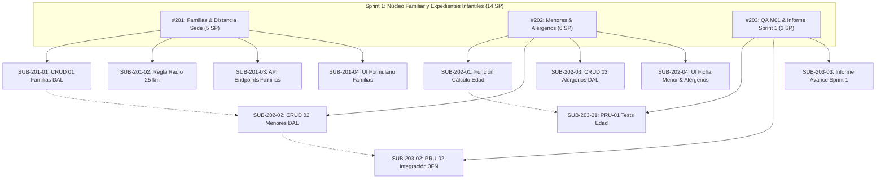

# Desglose de Subtareas Técnicas - Sprint 1: Gestión de Familias, Menores y Alérgenos

> **Proyecto:** EduCare Kids — Sistema Integral de Centro Infantil y Pedagógico  
> **Documento Vinculado:** [← Volver a Sprint_1.md](./Sprint_1.md) | [📋 Índice General del Backlog](./README.md)  
> **Sprint:** `Sprint 1` (12/11/2026 – 25/11/2026) | **Velocidad Total del Sprint:** 14 Story Points  
> **Metodología:** Solo-Scrum | **Entorno Tecnológico:** React/Next.js, Node.js/TypeScript, SQLite 3FN, Jest/Vitest  

---

## 📌 Resumen Ejecutivo de Subtareas del Sprint 1

En este primer sprint funcional del proyecto, las **3 Historias de Usuario y Tareas Técnicas** (HU 201, HU 202 y Tarea 203) se desglosan en un total de **11 Subtareas Técnicas (`Sub-tasks`)**, cubriendo la gestión de titulares familiares, la validación estática de distancia respecto a la sede central (≤ 25 km), la función de cálculo dinámico de edad de menores, el catálogo relacional de alérgenos y las suites de pruebas automatizadas (PRU-01 y PRU-02):

| ID Subtarea | Tarea / HU Padre | Título de la Subtarea Técnica | Capa / Módulo | Est. Horas | Estado |
| :---: | :---: | :--- | :---: | :---: | :---: |
| **SUB-201-01** | [#201](./Sprint_1.md#31-jira-id-201-gestión-de-titulares-familiares-con-dirección-postal-y-validación-estática-de-distancia-a-sede-m01---crud-01) | Repositorio y Servicio CRUD 01 (`familias`) con Baja Lógica en SQLite | Backend / DAL (M01) | 5 h | 🟩 Completado |
| **SUB-201-02** | [#201](./Sprint_1.md#31-jira-id-201-gestión-de-titulares-familiares-con-dirección-postal-y-validación-estática-de-distancia-a-sede-m01---crud-01) | Motor de Validación Estática de Distancia vs Sede Central (CRUD 15) | Lógica Dominio (M01/M07) | 3 h | 🟩 Completado |
| **SUB-201-03** | [#201](./Sprint_1.md#31-jira-id-201-gestión-de-titulares-familiares-con-dirección-postal-y-validación-estática-de-distancia-a-sede-m01---crud-01) | Endpoints de API REST / Server Actions para Gestión Familiar | Backend / API | 4 h | 🟩 Completado |
| **SUB-201-04** | [#201](./Sprint_1.md#31-jira-id-201-gestión-de-titulares-familiares-con-dirección-postal-y-validación-estática-de-distancia-a-sede-m01---crud-01) | Interfaz Web Adaptativa (React/Next.js) para Alta y Edición Familiar | Frontend / UI | 5 h | 🟩 Completado |
| **SUB-202-01** | [#202](./Sprint_1.md#32-jira-id-202-gestión-de-fichas-de-menores-con-cálculo-dinámico-de-edad-y-catálogo-relacional-de-alérgenos-m01---crud-02-y-03) | Función Pura TypeScript para Cálculo Dinámico de Edad y Clasificación | Lógica Dominio (M01) | 3 h | 🟩 Completado |
| **SUB-202-02** | [#202](./Sprint_1.md#32-jira-id-202-gestión-de-fichas-de-menores-con-cálculo-dinámico-de-edad-y-catálogo-relacional-de-alérgenos-m01---crud-02-y-03) | Repositorio y Servicio CRUD 02 (`menores`) con Llave Foránea a Familia | Backend / DAL (M01) | 4 h | 🟩 Completado |
| **SUB-202-03** | [#202](./Sprint_1.md#32-jira-id-202-gestión-de-fichas-de-menores-con-cálculo-dinámico-de-edad-y-catálogo-relacional-de-alérgenos-m01---crud-02-y-03) | Repositorio y Servicio CRUD 03 (`alergenos_menores`) y Pautas Médicas | Backend / DAL (M01) | 4 h | 🟩 Completado |
| **SUB-202-04** | [#202](./Sprint_1.md#32-jira-id-202-gestión-de-fichas-de-menores-con-cálculo-dinámico-de-edad-y-catálogo-relacional-de-alérgenos-m01---crud-02-y-03) | Interfaz UI de Expediente Infantil, Tags de Alérgenos y Alertas Médicas | Frontend / UI | 5 h | 🟩 Completado |
| **SUB-203-01** | [#203](./Sprint_1.md#33-jira-id-203-validación-sprint-1-ejecución-de-pruebas-unitariasintegración-de-m01-pru-01-pru-02-e-informe-de-avance-sprint-1) | Suite Automatizada de Pruebas Unitarias de Cálculo de Edad (PRU-01) | QA / Unit Testing | 3 h | 🟩 Completado |
| **SUB-203-02** | [#203](./Sprint_1.md#33-jira-id-203-validación-sprint-1-ejecución-de-pruebas-unitariasintegración-de-m01-pru-01-pru-02-e-informe-de-avance-sprint-1) | Suite de Integración 3FN de CRUD 01 a 03 con Restricciones FK (PRU-02) | QA / Integración 3FN | 4 h | 🟩 Completado |
| **SUB-203-03** | [#203](./Sprint_1.md#33-jira-id-203-validación-sprint-1-ejecución-de-pruebas-unitariasintegración-de-m01-pru-01-pru-02-e-informe-de-avance-sprint-1) | Redacción y Emisión del Informe de Avance del Sprint 1 | Gestión / Académico | 4 h | 🟩 Completado |
| **TOTAL** | **3 Ítems Padre** | **11 Subtareas Técnicas Detalladas** | **Cobertura Integral M01** | **44 h** | **Listo para Cierre** |

---

## 🛠️ Mapa de Dependencias de Subtareas (Sprint 1)

---

### 1. Ítem Padre: [#201] Gestión de titulares familiares con dirección postal y validación estática de distancia a sede (M01 - CRUD 01)
* **Tipo:** `Historia de Usuario` | **Estimación:** 5 SP | **Prioridad:** Highest
* **Rol:** Padre/Tutor o Administrador
* **Épica Padre:** Épica 1 (`EP01: Arquitectura Base, Base de Datos 3FN y Gestión de Familias`)

#### Subtarea `SUB-201-01`: Repositorio y Servicio CRUD 01 (`familias`) con Baja Lógica en SQLite
* **Tipo:** Subtarea Técnica (`Sub-task`)
* **Estimación de Esfuerzo:** 5 horas
* **Capa:** Backend / DAL (M01)
* **Descripción Detallada:**
  - Implementación de `FamiliaRepository.ts` y `FamiliaService.ts` operando sobre la tabla relacional `familias`:
    - **CREATE:** Alta de titulares familiares con los campos obligatorios: `id_familia` (UUID/Auto), `apellidos_familia`, `nombre_tutor_principal`, `dni_tutor`, `email`, `telefono`, `direccion_postal`, `codigo_postal`, `distancia_km_sede` y `activo` (por defecto 1).
    - **READ:** Consultas preparadas SQL (`SELECT * FROM familias WHERE activo = 1`), buscador por apellidos/DNI y consulta detallada por `id_familia`.
    - **UPDATE:** Modificación de datos de contacto, actualización de domicilio postal y recálculo de la distancia kilométrica respecto a la sede central.
    - **DELETE:** Implementación de borrado lógico (`UPDATE familias SET activo = 0 WHERE id_familia = ?`) para proteger la integridad histórica de facturas y citas.
* **Criterios de Aceptación Técnicos:**
  - Transacciones seguras con sentencias preparadas para prevenir inyección SQL.
  - Validación de formato de email y DNI/NIE español mediante expresiones regulares en la capa de servicio.

---

#### Subtarea `SUB-201-02`: Motor de Validación Estática de Distancia vs Sede Central (CRUD 15)
* **Tipo:** Subtarea Técnica (`Sub-task`)
* **Estimación de Esfuerzo:** 3 horas
* **Capa:** Lógica de Dominio (M01 / M07)
* **Descripción Detallada:**
  - Creación del validador de elegibilidad territorial `DistanceEligibilityService.ts`:
    - Lee de forma desacoplada el parámetro activo en `configuracion_sede` (CRUD 15), el cual estipula el radio máximo autorizado de **25.0 km**.
    - Compara la propiedad `distancia_km_sede` de la ficha familiar.
    - Si `distancia_km_sede <= 25.0`: Marca el campo virtual `apto_presencial = true` (habilita en la plataforma servicios de niñera a domicilio y clases presenciales).
    - Si `distancia_km_sede > 25.0`: Marca `apto_presencial = false` (restringe la cuenta familiar exclusivamente a contratación de servicios online y tutoría asíncrona).
* **Criterios de Aceptación Técnicos:**
  - Para un domicilio a 28 km, el sistema bloquea preventivamente la selección de servicios presenciales y emite mensaje informativo al usuario.
  - Para un domicilio a 12 km, se autoriza todo el abanico operativo.

---

#### Subtarea `SUB-201-03`: Endpoints de API REST / Server Actions para Gestión Familiar
* **Tipo:** Subtarea Técnica (`Sub-task`)
* **Estimación de Esfuerzo:** 4 horas
* **Capa:** Backend / API (Next.js App Router)
* **Descripción Detallada:**
  - Creación de rutas de API o Server Actions seguras en `src/app/api/familias/route.ts` y `src/app/api/familias/[id]/route.ts`:
    - `POST /api/familias`: Creación validada con DTO (`CreateFamiliaDTO`).
    - `GET /api/familias`: Listado con paginación y filtro de estado.
    - `GET /api/familias/:id`: Detalle completo con menores asociados.
    - `PUT /api/familias/:id`: Actualización de datos de perfil.
    - `DELETE /api/familias/:id`: Desactivación lógica.
  - Manejo centralizado de respuestas HTTP (200, 201, 400 por validación, 404 no encontrado y 500 error de servidor).
* **Criterios de Aceptación Técnicos:**
  - Respuestas JSON estructuradas con tipos TypeScript estrictos.

---

#### Subtarea `SUB-201-04`: Interfaz Web Adaptativa (React/Next.js) para Alta y Edición Familiar
* **Tipo:** Subtarea Técnica (`Sub-task`)
* **Estimación de Esfuerzo:** 5 horas
* **Capa:** Frontend / UI
* **Descripción Detallada:**
  - Desarrollo de los componentes visuales en `src/components/familias/`:
    - `FamiliaForm.tsx`: Formulario reactivo con validación de campos en tiempo real (React Hook Form / Zod).
    - `FamiliaCard.tsx` y `FamiliaList.tsx`: Vistas de catálogo y resumen de ficha familiar.
    - Badge visual informativo: `🟢 Apto Presencial (≤25 km)` o `🟠 Solo Online/Asíncrono (>25 km)`.
  - Diseño responsive adaptable a dispositivos móviles (360px+) y escritorios.
* **Criterios de Aceptación Técnicos:**
  - Interfaz accesible, con manejo de estados de carga (`loading skeletons`) y retroalimentación inmediata de errores.

---

### 2. Ítem Padre: [#202] Gestión de fichas de menores con cálculo dinámico de edad y catálogo relacional de alérgenos (M01 - CRUD 02 y 03)
* **Tipo:** `Historia de Usuario` | **Estimación:** 6 SP | **Prioridad:** Highest
* **Rol:** Padre/Tutor
* **Épica Padre:** Épica 1 (`EP01: Arquitectura Base, Base de Datos 3FN y Gestión de Familias`)

#### Subtarea `SUB-202-01`: Función Pura TypeScript para Cálculo Dinámico de Edad y Clasificación
* **Tipo:** Subtarea Técnica (`Sub-task`)
* **Estimación de Esfuerzo:** 3 horas
* **Capa:** Lógica de Dominio Pura (M01)
* **Descripción Detallada:**
  - Implementación de la función pura `calculateChildAge(birthDate: Date, referenceDate: Date = new Date())`:
    - Cumplimiento estricto de la **Tercera Forma Normal (3FN)**: la edad no se guarda en columnas estáticas de la base de datos (evitando datos obsoletos o redundantes).
    - Cálculo exacto de años, meses y días cumplidos.
    - Clasificación automática en las franjas operativas del centro:
      - **Franja Lactante (0 a 2 años):** Requiere recargo de cuidado del +30%.
      - **Franja Infantil (3 a 5 años):** Requiere recargo del +15%.
      - **Franja Escolar / Primaria / ESO (> 5 años):** Tarifa estándar base (0% recargo).
  - Manejo de años bisiestos y días exactos de cumpleaños.
* **Criterios de Aceptación Técnicos:**
  - Menor nacido hace 18 meses retorna exactamente `1 año y 6 meses (1.5 años)` y franja `LACTANTE_0_2`.
  - Menor de 4 años retorna `4 años` y franja `INFANTIL_3_5`.

---

#### Subtarea `SUB-202-02`: Repositorio y Servicio CRUD 02 (`menores`) con Llave Foránea a Familia
* **Tipo:** Subtarea Técnica (`Sub-task`)
* **Estimación de Esfuerzo:** 4 horas
* **Capa:** Backend / DAL (M01)
* **Descripción Detallada:**
  - Creación de `MenorRepository.ts` y `MenorService.ts` operando sobre la tabla `menores`:
    - **CREATE:** Alta de menor con `nombre`, `apellidos`, `fecha_nacimiento` obligatoria, `id_familia` (FK vinculada) y `observaciones_generales`.
    - **READ:** Consulta de hijos por núcleo familiar (`SELECT * FROM menores WHERE id_familia = ? AND activo = 1`), enriqueciendo dinámicamente cada registro con su edad calculada al vuelo.
    - **UPDATE:** Modificación de notas pedagógicas o datos personales.
    - **DELETE:** Baja lógica del menor garantizando que no se dejen menores desvinculados.
  - Verificación de la restricción `FOREIGN KEY (id_familia) REFERENCES familias(id_familia) ON DELETE RESTRICT`.
* **Criterios de Aceptación Técnicos:**
  - Imposibilidad de crear un menor sin una familia válida existente en base de datos.

---

#### Subtarea `SUB-202-03`: Repositorio y Servicio CRUD 03 (`alergenos_menores`) y Pautas Médicas
* **Tipo:** Subtarea Técnica (`Sub-task`)
* **Estimación de Esfuerzo:** 4 horas
* **Capa:** Backend / DAL (M01)
* **Descripción Detallada:**
  - Implementación de `AlergenoRepository.ts` y `AlergenoService.ts` operando sobre la tabla `alergenos_menores`:
    - **CREATE:** Registro de alergia, intolerancia (gluten, lactosa, frutos secos, huevo, etc.) o medicación periódica asociada a un menor mediante su `id_menor`. Incluye campos de severidad (Leve, Moderada, Grave/Anafilaxia) y protocolo de actuación urgente.
    - **READ:** Consulta de todos los alérgenos activos asociados al menor.
    - **UPDATE:** Ajuste de posología, instrucciones del pediatra o severidad.
    - **DELETE:** Desvinculación de alérgeno superado o eliminado.
* **Criterios de Aceptación Técnicos:**
  - Persistencia relacional normalizada 1:N entre `menores` y `alergenos_menores`.
  - Restricción de integridad referencial: si el menor es dado de baja, los alérgenos se archivan coherentemente.

---

#### Subtarea `SUB-202-04`: Interfaz UI de Expediente Infantil, Tags de Alérgenos y Alertas Médicas
* **Tipo:** Subtarea Técnica (`Sub-task`)
* **Estimación de Esfuerzo:** 5 horas
* **Capa:** Frontend / UI
* **Descripción Detallada:**
  - Desarrollo de la interfaz de usuario en `src/components/menores/`:
    - `MenorFormModal.tsx`: Modal para añadir o editar menor con selector de fecha de nacimiento (`DatePicker`) y cálculo de edad mostrado en vivo en la pantalla.
    - `AlergenosSelector.tsx`: Componente interactivo para seleccionar alérgenos comunes con chips de colores (Rojo: Anafilaxia/Grave, Amarillo: Moderado, Azul: Informativo) y campo de texto para pauta médica.
    - `ExpedienteMenorCard.tsx`: Ficha individual del niño con badge de edad en años/meses y banner de advertencia médica prominente.
* **Criterios de Aceptación Técnicos:**
  - El cuidador o docente visualiza de forma destacada las alertas médicas antes de iniciar cualquier reserva o sesión.

---

### 3. Ítem Padre: [#203] [VALIDACIÓN SPRINT 1] Ejecución de pruebas unitarias/integración de M01 (PRU-01, PRU-02) e Informe de Avance Sprint 1
* **Tipo:** `Tarea` (Estructurada como HU) | **Estimación:** 3 SP | **Prioridad:** Highest
* **Rol:** Responsable de QA y Gestión del Proyecto
* **Épica Padre:** Épica 6 (`Plan de Validación Continua por Sprint, Calidad (QA), Informes y Entrega Final`)

#### Subtarea `SUB-203-01`: Suite Automatizada de Pruebas Unitarias de Cálculo de Edad (PRU-01)
* **Tipo:** Subtarea Técnica (`Sub-task`)
* **Estimación de Esfuerzo:** 3 horas
* **Capa:** QA / Pruebas Unitarias
* **Descripción Detallada:**
  - Redacción de la suite `test/unit/age_calculator.test.ts`:
    - Caso 1: Menor nacido hace exactamente 18 meses ➔ Verifica `1.5 años` y tramo de recargo de lactante (+30%).
    - Caso 2: Menor de exactamente 4 años ➔ Verifica `4 años` y tramo infantil (+15%).
    - Caso 3: Menor recién nacido (0 días de vida).
    - Caso 4: Menor en el día exacto de su segundo y quinto cumpleaños (casos borde de cambio de franja tarifaria).
* **Criterios de Aceptación Técnicos:**
  - 100% de aserciones pasando sin fallos de redondeo en Jest/Vitest.

---

#### Subtarea `SUB-203-02`: Suite de Integración 3FN de CRUD 01 a 03 con Restricciones FK (PRU-02)
* **Tipo:** Subtarea Técnica (`Sub-task`)
* **Estimación de Esfuerzo:** 4 horas
* **Capa:** QA / Pruebas de Integración
* **Descripción Detallada:**
  - Redacción de la suite `test/integration/modulo_01_familias_menores.test.ts`:
    - Ciclo de vida completo: Crear familia ➔ Crear menor vinculado ➔ Crear 2 alérgenos vinculados al menor.
    - Verificación de consulta relacional con JOINs entre las 3 tablas.
    - Prueba negativa: Intentar eliminar la familia teniendo un menor activo ➔ Debe rechazar la operación por integridad referencial (`ON DELETE RESTRICT`).
    - Prueba de distancia: Familia a 28 km marca apto presencial en falso; familia a 12 km marca verdadero.
* **Criterios de Aceptación Técnicos:**
  - Todas las operaciones CRUD persisten correctamente en SQLite en memoria sin registros huérfanos.

---

#### Subtarea `SUB-203-03`: Redacción y Emisión del Informe de Avance del Sprint 1
* **Tipo:** Subtarea Técnica (`Sub-task`)
* **Estimación de Esfuerzo:** 4 horas
* **Capa:** Gestión Ágil / Académica
* **Descripción Detallada:**
  - Consolidación del documento formal: *Informe de Avance del Sprint 1*.
  - Resumen de velocidad: **14 Story Points alcanzados** (acumulado de 23 SP entre Sprint 0 y Sprint 1).
  - Certificación de los módulos M01 y M07.
  - Capturas de ejecución de la suite de pruebas automatizadas en consola.
  - Planificación detallada del **Sprint 2** (Catálogo de servicios, tarifas dinámicas por edad y materias escolares, con 14 SP).
* **Criterios de Aceptación Técnicos:**
  - Documento validado y archivado conforme a los estándares de entrega de la asignatura.

---

## 📋 Checklist de Certificación del Sprint 1 (Definition of Done)

- [x] **SUB-201-01 a SUB-201-04:** CRUD 01 (`familias`), validador de radio 25 km, API REST y formulario adaptativo frontend operativos.
- [x] **SUB-202-01 a SUB-202-04:** Función pura de cálculo de edad 3FN, CRUD 02 (`menores`), CRUD 03 (`alergenos_menores`) e interfaz de expediente completados.
- [x] **SUB-203-01 a SUB-203-03:** Pruebas unitarias de edad (PRU-01), integración 3FN (PRU-02) al 100% en verde e Informe de Avance del Sprint 1 emitido.
- [x] **Integridad Total:** 14 Story Points certificados sin errores de compilación ni regresiones en la base de datos.

---
*Archivo generado para el seguimiento granular de tareas técnicas del Sprint 1 en el proyecto EduCare Kids.*

