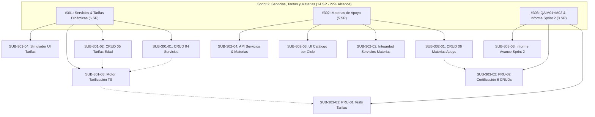

# Desglose de Subtareas Técnicas - Sprint 2: Catálogo de Servicios, Tarifas Dinámicas por Edad y Materias Escolares

> **Proyecto:** EduCare Kids — Sistema Integral de Centro Infantil y Pedagógico  
> **Documento Vinculado:** [← Volver a Sprint_2.md](./Sprint_2.md) | [📋 Índice General del Backlog](./README.md)  
> **Sprint:** `Sprint 2` (26/11/2026 – 09/12/2026) | **Velocidad Total del Sprint:** 14 Story Points  
> **Metodología:** Solo-Scrum | **Entorno Tecnológico:** React/Next.js, Node.js/TypeScript, SQLite 3FN, Jest/Vitest  

---

## 📌 Resumen Ejecutivo de Subtareas del Sprint 2

En este sprint se consolida el **22% del alcance práctico base del proyecto**, completando los primeros 6 CRUDs funcionales del sistema. Las **3 Historias de Usuario y Tareas Técnicas** (HU 301, HU 302 y Tarea 303) se desglosan en un total de **11 Subtareas Técnicas (`Sub-tasks`)**, cubriendo el catálogo de 4 modalidades de servicio, el motor matemático de tarificación dinámica con recargos etarios (+30% lactante y +15% infantil), el catálogo de materias escolares por ciclo educativo y la certificación de calidad (PRU-01 y PRU-02):

| ID Subtarea | Tarea / HU Padre | Título de la Subtarea Técnica | Capa / Módulo | Est. Horas | Estado |
| :---: | :---: | :--- | :---: | :---: | :---: |
| **SUB-301-01** | [#301](./Sprint_2.md#31-jira-id-301-catálogo-de-servicios-y-motor-de-tarifas-dinámicas-según-franja-de-edad-del-menor-m02---crud-04-y-05) | Repositorio y Servicio CRUD 04 (`servicios`) con 4 Modalidades en SQLite | Backend / DAL (M02) | 4 h | 🟩 Completado |
| **SUB-301-02** | [#301](./Sprint_2.md#31-jira-id-301-catálogo-de-servicios-y-motor-de-tarifas-dinámicas-según-franja-de-edad-del-menor-m02---crud-04-y-05) | Repositorio y Servicio CRUD 05 (`tarifas_edad`) con Tramos Paramétricos | Backend / DAL (M02) | 3 h | 🟩 Completado |
| **SUB-301-03** | [#301](./Sprint_2.md#31-jira-id-301-catálogo-de-servicios-y-motor-de-tarifas-dinámicas-según-franja-de-edad-del-menor-m02---crud-04-y-05) | Motor de Cálculo Tarifario en TypeScript (`PricingEngine.ts`) | Lógica Dominio (M02) | 4 h | 🟩 Completado |
| **SUB-301-04** | [#301](./Sprint_2.md#31-jira-id-301-catálogo-de-servicios-y-motor-de-tarifas-dinámicas-según-franja-de-edad-del-menor-m02---crud-04-y-05) | Panel Administrativo de Precios y Simulador en Vivo (React/Next.js) | Frontend / UI | 5 h | 🟩 Completado |
| **SUB-302-01** | [#302](./Sprint_2.md#32-jira-id-302-gestión-del-catálogo-de-asignaturas-y-etapas-escolares-para-apoyo-educativo-m02---crud-06) | Repositorio y Servicio CRUD 06 (`materias_apoyo`) por Etapa Escolar | Backend / DAL (M02) | 4 h | 🟩 Completado |
| **SUB-302-02** | [#302](./Sprint_2.md#32-jira-id-302-gestión-del-catálogo-de-asignaturas-y-etapas-escolares-para-apoyo-educativo-m02---crud-06) | Integración Referencial entre Modalidades de Apoyo y Materias Escolares | Backend / DAL (M02) | 3 h | 🟩 Completado |
| **SUB-302-03** | [#302](./Sprint_2.md#32-jira-id-302-gestión-del-catálogo-de-asignaturas-y-etapas-escolares-para-apoyo-educativo-m02---crud-06) | Interfaz de Catálogo Público con Filtro por Ciclo (Infantil/Primaria/ESO) | Frontend / UI | 5 h | 🟩 Completado |
| **SUB-302-04** | [#302](./Sprint_2.md#32-jira-id-302-gestión-del-catálogo-de-asignaturas-y-etapas-escolares-para-apoyo-educativo-m02---crud-06) | Endpoints de API REST / Server Actions para Servicios y Materias | Backend / API | 4 h | 🟩 Completado |
| **SUB-303-01** | [#303](./Sprint_2.md#33-jira-id-303-validación-sprint-2-certificación-de-pruebas-de-tarificación-dinámica-pru-01-pru-02-e-informe-de-avance-sprint-2) | Suite Automatizada de Tarificación Dinámica y Casos Borde (PRU-01) | QA / Unit Testing | 4 h | 🟩 Completado |
| **SUB-303-02** | [#303](./Sprint_2.md#33-jira-id-303-validación-sprint-2-certificación-de-pruebas-de-tarificación-dinámica-pru-01-pru-02-e-informe-de-avance-sprint-2) | Suite de Integración 3FN de CRUD 01 a 06 (PRU-02 - 22% de Alcance) | QA / Integración 3FN | 4 h | 🟩 Completado |
| **SUB-303-03** | [#303](./Sprint_2.md#33-jira-id-303-validación-sprint-2-certificación-de-pruebas-de-tarificación-dinámica-pru-01-pru-02-e-informe-de-avance-sprint-2) | Redacción y Emisión del Informe de Avance del Sprint 2 | Gestión / Académico | 4 h | 🟩 Completado |
| **TOTAL** | **3 Ítems Padre** | **11 Subtareas Técnicas Detalladas** | **Cobertura Integral M02** | **44 h** | **Listo para Cierre** |

---

## 🛠️ Mapa de Dependencias de Subtareas (Sprint 2)

---

### 1. Ítem Padre: [#301] Catálogo de servicios y motor de tarifas dinámicas según franja de edad del menor (M02 - CRUD 04 y 05)
* **Tipo:** `Historia de Usuario` | **Estimación:** 6 SP | **Prioridad:** Highest
* **Rol:** Administrador
* **Épica Padre:** Épica 2 (`EP02: Catálogo de Servicios, Tarifas Dinámicas por Edad y Materias`)

#### Subtarea `SUB-301-01`: Repositorio y Servicio CRUD 04 (`servicios`) con 4 Modalidades en SQLite
* **Tipo:** Subtarea Técnica (`Sub-task`)
* **Estimación de Esfuerzo:** 4 horas
* **Capa:** Backend / DAL (M02)
* **Descripción Detallada:**
  - Implementación de `ServicioRepository.ts` y `ServicioService.ts` operando sobre la tabla `servicios`:
    - **CREATE:** Alta de las 4 modalidades comerciales de EduCare Kids con su código identificador, nombre, descripción, tipo (Presencial / Remoto / Asíncrono), tarifa base por hora en céntimos/euros y estado activo:
      1. `SRV_NINERA`: Niñera a Domicilio (Tarifa base: 20.00 €/h | Presencial).
      2. `SRV_CLASE_PRES`: Clase Particular Presencial (Tarifa base: 22.00 €/h | Presencial).
      3. `SRV_CLASE_ONLINE`: Clase Particular Online (Tarifa base: 18.00 €/h | Remoto).
      4. `SRV_TUTORIA_ASINC`: Tutoría Asíncrona (Tarifa base: 15.00 €/h | Asíncrono).
    - **READ:** Catálogo de servicios activos con filtrado por tipo presencial o remoto.
    - **UPDATE:** Modificación de precios base y descripciones operativas.
    - **DELETE:** Baja lógica (`activo = 0`) para preservar históricos de facturación sin alterar presupuestos antiguos.
* **Criterios de Aceptación Técnicos:**
  - Almacenamiento exacto de tarifas sin pérdida de precisión decimal.

---

#### Subtarea `SUB-301-02`: Repositorio y Servicio CRUD 05 (`tarifas_edad`) con Tramos Paramétricos
* **Tipo:** Subtarea Técnica (`Sub-task`)
* **Estimación de Esfuerzo:** 3 horas
* **Capa:** Backend / DAL (M02)
* **Descripción Detallada:**
  - Implementación de `TarifasEdadRepository.ts` y `TarifasEdadService.ts` operando sobre `tarifas_edad`:
    - **CREATE:** Alta de reglas de recargo por intervalo de edad:
      - Tramo Lactante: `edad_min_meses = 0`, `edad_max_meses = 24`, `porcentaje_recargo = 30.0%`, `descripcion = "Recargo por alta dependencia y cuidados especiales"`.
      - Tramo Infantil: `edad_min_meses = 25`, `edad_max_meses = 60`, `porcentaje_recargo = 15.0%`, `descripcion = "Recargo por atención temprana e iniciación pedagógica"`.
      - Tramo Escolar: `edad_min_meses = 61`, `edad_max_meses = 216`, `porcentaje_recargo = 0.0%`, `descripcion = "Tarifa estándar para ciclo escolar"`.
    - **READ:** Consulta del tramo de recargo aplicable según los meses calculados del menor.
    - **UPDATE:** Capacidad del administrador para modificar los porcentajes de recargo desde el panel sin tocar código fuente.
    - **DELETE:** Desactivación lógica de reglas tarifarias obsoletas.
* **Criterios de Aceptación Técnicos:**
  - Restricción en SQLite: `CHECK (porcentaje_recargo >= 0 AND porcentaje_recargo <= 100)`.

---

#### Subtarea `SUB-301-03`: Motor de Cálculo Tarifario en TypeScript (`PricingEngine.ts`)
* **Tipo:** Subtarea Técnica (`Sub-task`)
* **Estimación de Esfuerzo:** 4 horas
* **Capa:** Lógica de Dominio Pura (M02)
* **Descripción Detallada:**
  - Implementación del servicio de dominio `PricingCalculationEngine.ts`:
    - Recibe el `id_servicio` y el `id_menor` (o fecha de nacimiento).
    - Obtiene la tarifa base $T_{base}$ desde `servicios` (CRUD 04).
    - Invoca a `calculateChildAge()` (M01 - CRUD 02) para obtener la edad exacta en meses.
    - Obtiene el porcentaje de recargo $R_{\%}$ desde `tarifas_edad` (CRUD 05).
    - Aplica la fórmula oficial:  
      $$T_{final} = T_{base} \times \left(1 + \frac{R_{\%}}{100}\right)$$
    - Casos representativos:
      - Niñera (20 €/h) + Lactante de 18 meses (+30%) ➔ $20 \times 1.30 = \mathbf{26.00\ €/h}$.
      - Niñera (20 €/h) + Niño de 4 años (+15%) ➔ $20 \times 1.15 = \mathbf{23.00\ €/h}$.
      - Niñera (20 €/h) + Niño de 8 años (0%) ➔ $20 \times 1.00 = \mathbf{20.00\ €/h}$.
* **Criterios de Aceptación Técnicos:**
  - Redondeo monetario formal a dos decimales (`Math.round(cents) / 100`) para evitar anomalías IEEE 754 de punto flotante en JavaScript.

---

#### Subtarea `SUB-301-04`: Panel Administrativo de Precios y Simulador en Vivo (React/Next.js)
* **Tipo:** Subtarea Técnica (`Sub-task`)
* **Estimación de Esfuerzo:** 5 horas
* **Capa:** Frontend / UI
* **Descripción Detallada:**
  - Desarrollo de interfaces en `src/components/tarifas/`:
    - `TarifasTable.tsx`: Tabla editable de precios base por modalidad y porcentajes de recargo.
    - `PricingSimulatorWidget.tsx`: Widget interactivo donde el usuario/padre selecciona un servicio del desplegable, introduce la edad de su hijo (o fecha de nacimiento) y observa en tiempo real el desglose tarifario (tarifa base, recargo aplicado y precio final por hora).
* **Criterios de Aceptación Técnicos:**
  - El simulador actualiza el precio reactivamente en menos de 50 ms al mover el deslizador o cambiar de servicio.

---

### 2. Ítem Padre: [#302] Gestión del catálogo de asignaturas y etapas escolares para apoyo educativo (M02 - CRUD 06)
* **Tipo:** `Historia de Usuario` | **Estimación:** 5 SP | **Prioridad:** High
* **Rol:** Administrador y Padre/Tutor
* **Épica Padre:** Épica 2 (`EP02: Catálogo de Servicios, Tarifas Dinámicas por Edad y Materias`)

#### Subtarea `SUB-302-01`: Repositorio y Servicio CRUD 06 (`materias_apoyo`) por Etapa Escolar
* **Tipo:** Subtarea Técnica (`Sub-task`)
* **Estimación de Esfuerzo:** 4 horas
* **Capa:** Backend / DAL (M02)
* **Descripción Detallada:**
  - Implementación de `MateriaRepository.ts` y `MateriaService.ts` operando sobre `materias_apoyo`:
    - **CREATE:** Alta de materias escolares estructuradas:
      - `nombre_materia`: Ej. Matemáticas, Lengua Castellana, Inglés, Apoyo a la Lectoescritura, Ciencias Naturales, Técnicas de Estudio.
      - `etapa_escolar`: Enum restringido (`INFANTIL`, `PRIMARIA`, `ESO`).
      - `descripcion_curricular`: Temarios clave cubiertos.
      - `activo`: 1.
    - **READ:** Listado público de asignaturas con filtro por etapa educativa.
    - **UPDATE:** Edición de temarios, metodologías o cambio de etapa.
    - **DELETE:** Baja lógica (`activo = 0`) para mantener la integridad histórica de reservas pasadas.
* **Criterios de Aceptación Técnicos:**
  - Restricción SQLite: `CHECK (etapa_escolar IN ('INFANTIL', 'PRIMARIA', 'ESO'))`.

---

#### Subtarea `SUB-302-02`: Integración Referencial entre Modalidades de Apoyo y Materias Escolares
* **Tipo:** Subtarea Técnica (`Sub-task`)
* **Estimación de Esfuerzo:** 3 horas
* **Capa:** Backend / Base de Datos 3FN (M02)
* **Descripción Detallada:**
  - Verificación y modelado de compatibilidad:
    - Las materias de apoyo solo aplican a los servicios pedagógicos: `SRV_CLASE_PRES`, `SRV_CLASE_ONLINE` y `SRV_TUTORIA_ASINC`.
    - No aplican al servicio de cuidados de `SRV_NINERA`.
  - Aseguramiento de integridad referencial para citas futuras y entregas de deberes asíncronas.
* **Criterios de Aceptación Técnicos:**
  - El sistema impide asociar una materia escolar a un servicio puramente asistencial de niñera.

---

#### Subtarea `SUB-302-03`: Interfaz de Catálogo Público con Filtro por Ciclo (Infantil/Primaria/ESO)
* **Tipo:** Subtarea Técnica (`Sub-task`)
* **Estimación de Esfuerzo:** 5 horas
* **Capa:** Frontend / UI
* **Descripción Detallada:**
  - Creación de componentes en `src/components/catalogo/`:
    - `ServiciosGrid.tsx`: Tarjetas interactivas con las 4 modalidades, iconos diferenciados (casa, pizarra, portátil, buzón) y tarifas base destacadas.
    - `MateriasFilterTabs.tsx`: Pestañas de filtrado rápido por ciclo escolar (`Infantil`, `Primaria`, `ESO`) mostrando etiquetas de asignaturas disponibles.
    - Modal explicativo con los objetivos pedagógicos de cada refuerzo.
* **Criterios de Aceptación Técnicos:**
  - Diseño responsive optimizado para navegación ágil desde smartphones y tablets.

---

#### Subtarea `SUB-302-04`: Endpoints de API REST / Server Actions para Servicios y Materias
* **Tipo:** Subtarea Técnica (`Sub-task`)
* **Estimación de Esfuerzo:** 4 horas
* **Capa:** Backend / API
* **Descripción Detallada:**
  - Desarrollo de rutas API en Next.js:
    - `GET /api/servicios`: Retorna modalidades activas.
    - `PUT /api/servicios/:id`: Actualización de tarifas base (solo rol administrador).
    - `GET /api/materias?etapa=PRIMARIA`: Consulta de materias filtradas.
    - `POST /api/materias`: Alta de nueva asignatura escolar.
    - `POST /api/tarifas/calcular`: Endpoint para cotización dinámica remota enviando `id_servicio` y `fecha_nacimiento_menor`.
* **Criterios de Aceptación Técnicos:**
  - Respuestas JSON cacheadas eficientemente mediante Next.js `revalidateTag` ante actualizaciones de precios.

---

### 3. Ítem Padre: [#303] [VALIDACIÓN SPRINT 2] Certificación de pruebas de tarificación dinámica (PRU-01, PRU-02) e Informe de Avance Sprint 2
* **Tipo:** `Tarea` (Estructurada como HU) | **Estimación:** 3 SP | **Prioridad:** Highest
* **Rol:** Responsable de QA y Gestión del Proyecto
* **Épica Padre:** Épica 6 (`Plan de Validación Continua por Sprint, Calidad (QA), Informes y Entrega Final`)

#### Subtarea `SUB-303-01`: Suite Automatizada de Tarificación Dinámica y Casos Borde (PRU-01)
* **Tipo:** Subtarea Técnica (`Sub-task`)
* **Estimación de Esfuerzo:** 4 horas
* **Capa:** QA / Pruebas Unitarias
* **Descripción Detallada:**
  - Redacción de la suite `test/unit/pricing_engine.test.ts`:
    - Comprobación matemática exacta:
      - `20.00 EUR * 1.30 = 26.00 EUR` (lactante 18 meses).
      - `20.00 EUR * 1.15 = 23.00 EUR` (menor 4 años).
      - `22.00 EUR * 1.15 = 25.30 EUR` (clase particular presencial a menor de 4 años).
      - `18.00 EUR * 1.00 = 18.00 EUR` (clase online a escolar de 9 años).
    - Verificación de casos límite temporales: Menor con exactamente 24 meses (2.0 años cumplidos) vs menor con 25 meses.
* **Criterios de Aceptación Técnicos:**
  - 100% de aserciones en verde con precisión al céntimo de euro.

---

#### Subtarea `SUB-303-02`: Suite de Integración 3FN de CRUD 01 a 06 (PRU-02 - 22% de Alcance)
* **Tipo:** Subtarea Técnica (`Sub-task`)
* **Estimación de Esfuerzo:** 4 horas
* **Capa:** QA / Pruebas de Integración 3FN
* **Descripción Detallada:**
  - Redacción de la suite `test/integration/modulo_02_catalogo_tarifas.test.ts`:
    - Verificación integral de persistencia de los 6 primeros CRUDs en SQLite aislado:
      - CRUD 01 (`familias`)
      - CRUD 02 (`menores`)
      - CRUD 03 (`alergenos_menores`)
      - CRUD 04 (`servicios`)
      - CRUD 05 (`tarifas_edad`)
      - CRUD 06 (`materias_apoyo`)
    - Certificación del cumplimiento de la Tercera Forma Normal (3FN), ausencia de valores nulos no controlados y llaves foráneas consistentes.
* **Criterios de Aceptación Técnicos:**
  - Ejecución integral sin errores de restricción SQL en Jest/Vitest.

---

#### Subtarea `SUB-303-03`: Redacción y Emisión del Informe de Avance del Sprint 2
* **Tipo:** Subtarea Técnica (`Sub-task`)
* **Estimación de Esfuerzo:** 4 horas
* **Capa:** Gestión Ágil / Académica
* **Descripción Detallada:**
  - Consolidación del documento formal: *Informe de Avance del Sprint 2*.
  - Hito destacado: **Certificación del 22% del alcance práctico base del proyecto**.
  - Velocidad alcanzada: **14 Story Points** (acumulado de 37 SP en los Sprints 0, 1 y 2).
  - Capturas de consola de las pruebas PRU-01 y PRU-02.
  - Planificación detallada del **Sprint 3** (Calendario reactivo, zonas viales y motor autónomo P01 con 15 SP).
* **Criterios de Aceptación Técnicos:**
  - Informe formal emitido y validado para la Memoria Técnica de la asignatura.

---

## 📋 Checklist de Certificación del Sprint 2 (Definition of Done)

- [x] **SUB-301-01 a SUB-301-04:** CRUD 04 (`servicios`), CRUD 05 (`tarifas_edad`), motor matemático en TypeScript y simulador visual en vivo operativos.
- [x] **SUB-302-01 a SUB-302-04:** CRUD 06 (`materias_apoyo`), integración de etapas escolares (Infantil/Primaria/ESO) y catálogo público adaptativo completados.
- [x] **SUB-303-01 a SUB-303-03:** Pruebas unitarias de tarificación (PRU-01), integración de los primeros 6 CRUDs (PRU-02 - 22% de alcance) en verde e Informe de Avance emitido.
- [x] **Integridad Total:** 14 Story Points certificados sin errores de compilación ni regresiones relacionales.

---
*Archivo generado para el seguimiento granular de tareas técnicas del Sprint 2 en el proyecto EduCare Kids.*

