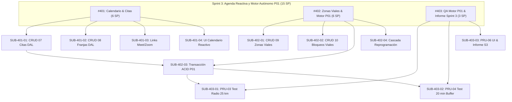

# Desglose de Subtareas Técnicas - Sprint 3: Calendario Reactivo, Reservas y Motor Autónomo de Desplazamiento Vial

> **Proyecto:** EduCare Kids — Sistema Integral de Centro Infantil y Pedagógico  
> **Documento Vinculado:** [← Volver a Sprint_3.md](./Sprint_3.md) | [📋 Índice General del Backlog](./README.md)  
> **Sprint:** `Sprint 3` (10/12/2026 – 23/12/2026) | **Velocidad Total del Sprint:** 15 Story Points  
> **Metodología:** Solo-Scrum | **Entorno Tecnológico:** React/Next.js, Node.js/TypeScript, SQLite 3FN, Jest/Vitest  

---

## 📌 Resumen Ejecutivo de Subtareas del Sprint 3

En este sprint se implementa el núcleo logístico más sofisticado del sistema: el **Calendario Reactivo de Citas** y el **Motor Autónomo de Desplazamiento Vial (P01)**. Las **3 incidencias del Backlog** (HU 401, HU 402 y Tarea 403) se desglosan en un total de **11 Subtareas Técnicas (`Sub-tasks`)**, sumando 46 horas de esfuerzo estimado:

| ID Subtarea | Tarea / HU Padre | Título de la Subtarea Técnica | Capa / Módulo | Est. Horas | Estado |
| :---: | :---: | :--- | :---: | :---: | :---: |
| **SUB-401-01** | [#401](./Sprint_3.md#31-jira-id-401-calendario-interactivo-semanalmensual-reserva-de-citas-y-gestión-de-franjas-horarias-m03---crud-07-y-08) | Repositorio y Servicio CRUD 07 (`citas`) con Algoritmo Anti-Solapamiento | Backend / DAL (M03) | 5 h | 🟩 Completado |
| **SUB-401-02** | [#401](./Sprint_3.md#31-jira-id-401-calendario-interactivo-semanalmensual-reserva-de-citas-y-gestión-de-franjas-horarias-m03---crud-07-y-08) | Repositorio y Servicio CRUD 08 (`franjas_horarias`) y Turnos Operativos | Backend / DAL (M03) | 3 h | 🟩 Completado |
| **SUB-401-03** | [#401](./Sprint_3.md#31-jira-id-401-calendario-interactivo-semanalmensual-reserva-de-citas-y-gestión-de-franjas-horarias-m03---crud-07-y-08) | Generador de Enlaces Dinámicos para Modalidades Online (Meet / Zoom) | Integración / Lógica | 3 h | 🟩 Completado |
| **SUB-401-04** | [#401](./Sprint_3.md#31-jira-id-401-calendario-interactivo-semanalmensual-reserva-de-citas-y-gestión-de-franjas-horarias-m03---crud-07-y-08) | Interfaz de Calendario Semanal/Mensual Reactivo con Bloqueo de Casilleros | Frontend / UI (Next.js) | 6 h | 🟩 Completado |
| **SUB-402-01** | [#402](./Sprint_3.md#32-jira-id-402-zonas-viales-bloqueos-de-20-min-y-motor-autónomo-p01-de-validación-de-distancia-25-km-m04---crud-09-10-y-p01) | Repositorio y Servicio CRUD 09 (`zonas_desplazamiento`) con Tramos Km | Backend / DAL (M04) | 3 h | 🟩 Completado |
| **SUB-402-02** | [#402](./Sprint_3.md#32-jira-id-402-zonas-viales-bloqueos-de-20-min-y-motor-autónomo-p01-de-validación-de-distancia-25-km-m04---crud-09-10-y-p01) | Repositorio y Servicio CRUD 10 (`bloqueos_viales`) para Franjas Técnicas | Backend / DAL (M04) | 4 h | 🟩 Completado |
| **SUB-402-03** | [#402](./Sprint_3.md#32-jira-id-402-zonas-viales-bloqueos-de-20-min-y-motor-autónomo-p01-de-validación-de-distancia-25-km-m04---crud-09-10-y-p01) | Motor Autónomo P01: Transacción Atómica ACID en SQLite (Cita + 2 Bloqueos) | Proceso Autónomo (P01) | 5 h | 🟩 Completado |
| **SUB-402-04** | [#402](./Sprint_3.md#32-jira-id-402-zonas-viales-bloqueos-de-20-min-y-motor-autónomo-p01-de-validación-de-distancia-25-km-m04---crud-09-10-y-p01) | Sincronización en Cascada de Bloqueos Viales (Reprogramación y Anulación) | Lógica Dominio (M04) | 4 h | 🟩 Completado |
| **SUB-403-01** | [#403](./Sprint_3.md#33-jira-id-403-validación-sprint-3-ejecución-de-pruebas-del-motor-autónomo-p01-pru-03-pru-04-pru-06-e-informe-de-avance-sprint-3) | Suite Automatizada de Validación de Distancia Límite de 25 km (PRU-03) | QA / Integración P01 | 4 h | 🟩 Completado |
| **SUB-403-02** | [#403](./Sprint_3.md#33-jira-id-403-validación-sprint-3-ejecución-de-pruebas-del-motor-autónomo-p01-pru-03-pru-04-pru-06-e-informe-de-avance-sprint-3) | Suite Automatizada de Inserción de Bloqueos Viales de 20 min (PRU-04) | QA / Integración P01 | 4 h | 🟩 Completado |
| **SUB-403-03** | [#403](./Sprint_3.md#33-jira-id-403-validación-sprint-3-ejecución-de-pruebas-del-motor-autónomo-p01-pru-03-pru-04-pru-06-e-informe-de-avance-sprint-3) | Pruebas de Interfaz UI Anti-Colisión (PRU-06) e Informe Sprint 3 | QA / UI & Gestión | 5 h | 🟩 Completado |
| **TOTAL** | **3 Ítems Padre** | **11 Subtareas Técnicas Detalladas** | **Cobertura M03, M04 y P01** | **46 h** | **Listo para Cierre** |

---

## 🛠️ Flujo Transaccional del Motor Autónomo P01 y Subtareas



---

### 1. Ítem Padre: [#401] Calendario interactivo semanal/mensual, reserva de citas y gestión de franjas horarias (M03 - CRUD 07 y 08)
* **Tipo:** `Historia de Usuario` | **Estimación:** 6 SP | **Prioridad:** Highest
* **Rol:** Padre/Tutor o Administrador
* **Épica Padre:** Épica 3 (`EP03: Calendario Reactivo, Reservas y Motor Autónomo de Desplazamiento Vial`)

#### Subtarea `SUB-401-01`: Repositorio y Servicio CRUD 07 (`citas`) con Algoritmo Anti-Solapamiento
* **Tipo:** Subtarea Técnica (`Sub-task`)
* **Estimación de Esfuerzo:** 5 horas
* **Capa:** Backend / DAL (M03)
* **Descripción Detallada:**
  - Implementación de `CitaRepository.ts` y `CitaService.ts` operando sobre `citas`:
    - **CREATE:** Alta de reserva vinculando `id_familia`, `id_menor`, `id_servicio`, fecha, `hora_inicio`, `hora_fin`, importe total calculado y estado (`CONFIRMADA`, `PENDIENTE`, `CANCELADA`).
    - **READ:** Consulta de agenda con filtros por familia, profesional o vista global del administrador.
    - **UPDATE:** Reprogramación de fecha/horario y cambios de estado operativo.
    - **DELETE:** Cancelación lógica de la reserva liberando de inmediato la disponibilidad en la agenda.
  - Algoritmo de detección de colisiones en SQLite:
    ```sql
    SELECT COUNT(*) FROM citas 
    WHERE estado = 'CONFIRMADA' 
      AND fecha = :fecha 
      AND (hora_inicio < :nueva_fin AND hora_fin > :nueva_inicio);
    ```
* **Criterios de Aceptación Técnicos:**
  - Si la consulta arroja recuento $> 0$, la operación rechaza la inserción con error `CONFLICT_SLOT_OCCUPIED`.

---

#### Subtarea `SUB-401-02`: Repositorio y Servicio CRUD 08 (`franjas_horarias`) y Turnos Operativos
* **Tipo:** Subtarea Técnica (`Sub-task`)
* **Estimación de Esfuerzo:** 3 horas
* **Capa:** Backend / DAL (M03)
* **Descripción Detallada:**
  - Implementación de `FranjasHorariasRepository.ts` y `FranjasHorariasService.ts`:
    - **CREATE:** Configuración de cuadrantes de apertura del centro (ej. Lunes a Viernes 08:00 a 20:00, Sábados 09:00 a 14:00) y registro de días festivos o no laborables.
    - **READ:** Consulta de cuadrantes disponibles para la interfaz de reservas.
    - **UPDATE:** Bloqueos administrativos temporales de franjas por mantenimiento o formación.
    - **DELETE:** Eliminación o desactivación de turnos obsoletos.
* **Criterios de Aceptación Técnicos:**
  - El sistema no permite solicitar reservas en horas o días marcados como no laborables en CRUD 08.

---

#### Subtarea `SUB-401-03`: Generador de Enlaces Dinámicos para Modalidades Online (Meet / Zoom)
* **Tipo:** Subtarea Técnica (`Sub-task`)
* **Estimación de Esfuerzo:** 3 horas
* **Capa:** Lógica de Negocio / Integración Externa (M03)
* **Descripción Detallada:**
  - Servicio `VirtualMeetingLinkService.ts`:
    - Si el servicio contratado es `SRV_CLASE_ONLINE`: Genera automáticamente una URL segura de sala virtual (Google Meet o Zoom simulado con identificador criptográfico único).
    - Persiste el campo `enlace_reunion` en la tabla `citas`.
    - Envía la URL en el payload de confirmación tanto al padre como al docente.
* **Criterios de Aceptación Técnicos:**
  - Las citas presenciales (`SRV_NINERA` y `SRV_CLASE_PRES`) dejan el campo en `NULL`, mientras que las online generan un enlace HTTPS válido.

---

#### Subtarea `SUB-401-04`: Interfaz de Calendario Semanal/Mensual Reactivo con Bloqueo de Casilleros
* **Tipo:** Subtarea Técnica (`Sub-task`)
* **Estimación de Esfuerzo:** 6 horas
* **Capa:** Frontend / UI (React/Next.js)
* **Descripción Detallada:**
  - Creación de componentes en `src/components/calendario/`:
    - `InteractiveCalendarGrid.tsx`: Vista semanal/mensual interactiva basada en CSS Grid / Flexbox adaptativo.
    - Casilleros de turnos con codificación de colores:
      - 🟩 Verde: Franja libre disponible para reservar.
      - 🟥 Rojo / Gris rayado: Turno ocupado por otra cita (deshabilitado para clic).
      - 🟨 Ámbar: Bloqueo técnico vial por desplazamiento (P01).
    - Modal de confirmación de reserva mostrando desglose de servicio, menor y tarifa estimada.
* **Criterios de Aceptación Técnicos:**
  - Los casilleros ocupados no admiten eventos `onClick` y muestran un tooltip informativo indicando turno no disponible.

---

### 2. Ítem Padre: [#402] Zonas viales, bloqueos de 20 min y motor autónomo P01 de validación de distancia <=25 km (M04 - CRUD 09, 10 y P01)
* **Tipo:** `Historia de Usuario` | **Estimación:** 6 SP | **Prioridad:** Highest
* **Rol:** Sistema Autónomo (P01) y Administrador
* **Épica Padre:** Épica 3 (`EP03: Calendario Reactivo, Reservas y Motor Autónomo de Desplazamiento Vial`)

#### Subtarea `SUB-402-01`: Repositorio y Servicio CRUD 09 (`zonas_desplazamiento`) con Tramos Km
* **Tipo:** Subtarea Técnica (`Sub-task`)
* **Estimación de Esfuerzo:** 3 horas
* **Capa:** Backend / DAL (M04)
* **Descripción Detallada:**
  - Implementación de `ZonaDesplazamientoRepository.ts` y `ZonaDesplazamientoService.ts`:
    - **CREATE:** Alta de tramos viales concéntricos hasta el límite de 25 km:
      - Tramo 1 (0 a 5 km): Suplemento de desplazamiento 0.00 € | Tiempo vial estimado 10 min.
      - Tramo 2 (5.1 a 15 km): Suplemento de desplazamiento 5.00 € | Tiempo vial estimado 20 min.
      - Tramo 3 (15.1 a 25 km): Suplemento de desplazamiento 10.00 € | Tiempo vial estimado 25 min.
    - **READ:** Consulta del suplemento económico y tiempo vial en función de los kilómetros del domicilio familiar.
    - **UPDATE:** Ajuste de importes de transporte.
    - **DELETE:** Desactivación de tramos viales.
* **Criterios de Aceptación Técnicos:**
  - Restricción estricta: `CHECK (km_max <= 25.0)`.

---

#### Subtarea `SUB-402-02`: Repositorio y Servicio CRUD 10 (`bloqueos_viales`) para Franjas Técnicas
* **Tipo:** Subtarea Técnica (`Sub-task`)
* **Estimación de Esfuerzo:** 4 horas
* **Capa:** Backend / DAL (M04)
* **Descripción Detallada:**
  - Implementación de `BloqueosVialesRepository.ts` y `BloqueosVialesService.ts` operando sobre `bloqueos_viales`:
    - Estructura: `id_bloqueo`, `id_cita` (FK vinculada a `citas`), `tipo_bloqueo` (`PREVIO_IDA`, `POSTERIOR_RETORNO`), `hora_inicio`, `hora_fin`, `duracion_minutos` (por defecto 20) y `motivo`.
    - **CREATE:** Inserción técnica automática gobernada exclusivamente por el proceso P01.
    - **READ:** Consulta de bloqueos para renderizar franjas reservadas en el calendario del centro.
    - **UPDATE:** Ajuste automático de horas si la cita asociada cambia de horario.
    - **DELETE:** Liberación automática de las dos franjas si la cita asociada es cancelada.
* **Criterios de Aceptación Técnicos:**
  - Llave foránea en cascada o gestión transaccional que impida la existencia de bloqueos viales huérfanos.

---

#### Subtarea `SUB-402-03`: Motor Autónomo P01: Transacción Atómica ACID en SQLite (Cita + 2 Bloqueos)
* **Tipo:** Subtarea Técnica (`Sub-task`)
* **Estimación de Esfuerzo:** 5 horas
* **Capa:** Proceso Autónomo / Backend Transaccional (P01)
* **Descripción Detallada:**
  - Implementación del servicio autónomo `P01RoadMovementEngine.ts`:
    - Recibe solicitud de cita presencial en domicilio (ej. Cita de 16:00 a 18:00 para familia situada a 12 km).
    - **Paso 1 (Validación de Radio):** Comprueba `distancia_km_sede <= 25.0`. Si la distancia es 28 km, aborta inmediatamente con excepción `OUT_OF_SERVICE_RADIUS_ERROR`.
    - **Paso 2 (Transacción ACID):**
      ```sql
      BEGIN TRANSACTION;
        -- 1. Insertar Cita en tabla citas (CRUD 07)
        INSERT INTO citas (id_cita, fecha, hora_inicio, hora_fin, ...) 
        VALUES ('CIT-100', '2026-12-18', '16:00', '18:00', ...);

        -- 2. Insertar Bloqueo Previo de 20 min (CRUD 10)
        INSERT INTO bloqueos_viales (id_cita, tipo_bloqueo, hora_inicio, hora_fin)
        VALUES ('CIT-100', 'PREVIO_IDA', '15:40', '16:00');

        -- 3. Insertar Bloqueo Posterior de 20 min (CRUD 10)
        INSERT INTO bloqueos_viales (id_cita, tipo_bloqueo, hora_inicio, hora_fin)
        VALUES ('CIT-100', 'POSTERIOR_RETORNO', '18:00', '18:20');
      COMMIT;
      ```
    - Si cualquier paso falla por colisión horaria, toda la transacción se revierte con `ROLLBACK`.
* **Criterios de Aceptación Técnicos:**
  - Atomicidad garantizada: es imposible que exista una cita presencial sin sus dos bloqueos viales de 20 minutos asociados.

---

#### Subtarea `SUB-402-04`: Sincronización en Cascada de Bloqueos Viales (Reprogramación y Anulación)
* **Tipo:** Subtarea Técnica (`Sub-task`)
* **Estimación de Esfuerzo:** 4 horas
* **Capa:** Lógica de Dominio (M04 / P01)
* **Descripción Detallada:**
  - Implementación de handlers de eventos de agenda:
    - **Evento Reprogramación:** Si la cita se traslada de 16:00-18:00 a 10:00-12:00, P01 recalcula y actualiza automáticamente los bloqueos viales a 09:40-10:00 y 12:00-12:20, validando previamente que la nueva franja completa esté libre.
    - **Evento Cancelación:** Si la cita se cancela, se eliminan o desactivan los dos bloqueos asociados, liberando 2 horas y 40 minutos en el cuadrante del profesional.
* **Criterios de Aceptación Técnicos:**
  - No quedan ventanas residuales bloqueadas tras cancelaciones o cambios de hora.

---

### 3. Ítem Padre: [#403] [VALIDACIÓN SPRINT 3] Ejecución de pruebas del motor autónomo P01 (PRU-03, PRU-04, PRU-06) e Informe de Avance Sprint 3
* **Tipo:** `Tarea` (Estructurada como HU) | **Estimación:** 3 SP | **Prioridad:** Highest
* **Rol:** Responsable de QA y Gestión del Proyecto
* **Épica Padre:** Épica 6 (`Plan de Validación Continua por Sprint, Calidad (QA), Informes y Entrega Final`)

#### Subtarea `SUB-403-01`: Suite Automatizada de Validación de Distancia Límite de 25 km (PRU-03)
* **Tipo:** Subtarea Técnica (`Sub-task`)
* **Estimación de Esfuerzo:** 4 horas
* **Capa:** QA / Pruebas Automatizadas
* **Descripción Detallada:**
  - Redacción de la suite `test/qa/pru_03_distance_limit.test.ts` en Jest/Vitest:
    - Escenario 1: Familia a 28 km de la sede central intenta reservar servicio presencial de niñera ➔ El motor P01 rechaza la reserva y arroja código de error de radio superado.
    - Escenario 2: La misma familia a 28 km reserva tutoría asíncrona o clase online ➔ La reserva es aceptada con éxito sin bloqueos viales.
* **Criterios de Aceptación Técnicos:**
  - Aserciones verificando que el radio límite de 25 km configurado en sede actúa como barrera estricta.

---

#### Subtarea `SUB-403-02`: Suite Automatizada de Inserción de Bloqueos Viales de 20 min (PRU-04)
* **Tipo:** Subtarea Técnica (`Sub-task`)
* **Estimación de Esfuerzo:** 4 horas
* **Capa:** QA / Pruebas Automatizadas
* **Descripción Detallada:**
  - Redacción de la suite `test/qa/pru_04_vial_blocks.test.ts`:
    - Escenario: Familia a 12 km reserva cita de 16:00 a 18:00.
    - Aserción 1: Comprobar inserción en tabla `citas`.
    - Aserción 2: Consultar `bloqueos_viales` por `id_cita` y verificar existencia de exactamente 2 registros.
    - Aserción 3: Verificar que el primer registro tiene `hora_inicio = '15:40'` y `hora_fin = '16:00'`.
    - Aserción 4: Verificar que el segundo registro tiene `hora_inicio = '18:00'` y `hora_fin = '18:20'`.
* **Criterios de Aceptación Técnicos:**
  - 100% de aserciones validadas contra una instancia SQLite en memoria.

---

#### Subtarea `SUB-403-03`: Pruebas de Interfaz UI Anti-Colisión (PRU-06) e Informe Sprint 3
* **Tipo:** Subtarea Técnica (`Sub-task`)
* **Estimación de Esfuerzo:** 5 horas
* **Capa:** QA / Testing UI & Gestión
* **Descripción Detallada:**
  - Testing de componentes con React Testing Library (PRU-06):
    - Comprobar que los casilleros de 15:40 a 18:20 aparecen marcados como deshabilitados en el calendario web interactivo.
    - Simular intento de clic sobre franja bloqueada y verificar que no se dispara el modal de reserva.
  - Consolidación del *Informe de Avance del Sprint 3*:
    - Velocidad lograda: **15 Story Points** (acumulado de 52 SP en Sprints 0, 1, 2 y 3).
    - Certificación formal del funcionamiento del motor autónomo P01.
    - Planificación del **Sprint 4** (Monedero de bonos prepago, débito P02 y alerta P03 con 15 SP).
* **Criterios de Aceptación Técnicos:**
  - Suite PRU-06 en verde y documento del informe completado.

---

## 📋 Checklist de Certificación del Sprint 3 (Definition of Done)

- [x] **SUB-401-01 a SUB-401-04:** CRUD 07 (`citas`), CRUD 08 (`franjas_horarias`), generador de salas Meet/Zoom y calendario interactivo web finalizados.
- [x] **SUB-402-01 a SUB-402-04:** CRUD 09 (`zonas_desplazamiento`), CRUD 10 (`bloqueos_viales`), motor P01 transaccional ACID y cascada de sincronización operativos.
- [x] **SUB-403-01 a SUB-403-03:** Pruebas automatizadas de radio 25 km (PRU-03), bloqueos de 20 min (PRU-04) y UI anti-solapamiento (PRU-06) al 100% en verde con Informe de Avance emitido.
- [x] **Integridad Total:** 15 Story Points completados sin fallos de concurrencia ni colisiones de agenda.

---
*Archivo generado para el seguimiento granular de tareas técnicas del Sprint 3 en el proyecto EduCare Kids.*

