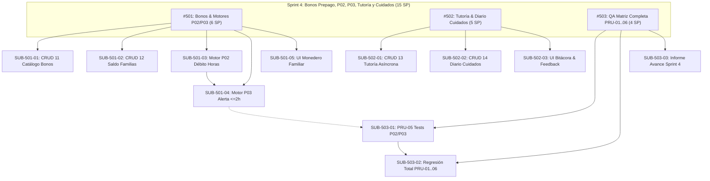

# Desglose de Subtareas Técnicas - Sprint 4: Monedero de Bonos Prepago, Tutoría Asíncrona y Diario de Cuidados

> **Proyecto:** EduCare Kids — Sistema Integral de Centro Infantil y Pedagógico  
> **Documento Vinculado:** [← Volver a Sprint_4.md](./Sprint_4.md) | [📋 Índice General del Backlog](./README.md)  
> **Sprint:** `Sprint 4` (24/12/2026 – 06/01/2027) | **Velocidad Total del Sprint:** 15 Story Points  
> **Metodología:** Solo-Scrum | **Entorno Tecnológico:** React/Next.js, Node.js/TypeScript, SQLite 3FN, Jest/Vitest  

---

## 📌 Resumen Ejecutivo de Subtareas del Sprint 4

En este sprint se implementan los sistemas de fidelización y seguimiento del cuidado: el **Monedero de Bonos Prepago**, los **Procesos Autónomos P02 (Débito)** y **P03 (Alerta Saldo ≤ 2h)**, el **Buzón de Tutoría Asíncrona** y el **Diario de Cuidados Infantiles**, culminando con la **ejecución integral de toda la Matriz de Pruebas (PRU-01 a PRU-06)**. Las 3 incidencias (HU 501, HU 502 y Tarea 503) se desglosan en **11 Subtareas Técnicas (`Sub-tasks`)**, sumando 46 horas estimadas:

| ID Subtarea | Tarea / HU Padre | Título de la Subtarea Técnica | Capa / Módulo | Est. Horas | Estado |
| :---: | :---: | :--- | :---: | :---: | :---: |
| **SUB-501-01** | [#501](./Sprint_4.md#31-jira-id-501-catálogo-de-bonos-prepago-saldos-familiares-y-procesos-autónomos-de-débito-y-alerta-2h-m05---crud-11-12-p02-p03) | Repositorio y Servicio CRUD 11 (`catalogo_bonos`) con Paquetes de 5h, 10h y 20h | Backend / DAL (M05) | 4 h | 🟩 Completado |
| **SUB-501-02** | [#501](./Sprint_4.md#31-jira-id-501-catálogo-de-bonos-prepago-saldos-familiares-y-procesos-autónomos-de-débito-y-alerta-2h-m05---crud-11-12-p02-p03) | Repositorio y Servicio CRUD 12 (`bonos_familias`) con Saldo y Movimientos | Backend / DAL (M05) | 4 h | 🟩 Completado |
| **SUB-501-03** | [#501](./Sprint_4.md#31-jira-id-501-catálogo-de-bonos-prepago-saldos-familiares-y-procesos-autónomos-de-débito-y-alerta-2h-m05---crud-11-12-p02-p03) | Motor Autónomo P02: Deducción Transaccional de Horas al Confirmar Reserva | Proceso Autónomo (P02) | 4 h | 🟩 Completado |
| **SUB-501-04** | [#501](./Sprint_4.md#31-jira-id-501-catálogo-de-bonos-prepago-saldos-familiares-y-procesos-autónomos-de-débito-y-alerta-2h-m05---crud-11-12-p02-p03) | Motor Autónomo P03: Monitor de Umbral ≤ 2h, Alerta Auditada y Notificación | Proceso Autónomo (P03) | 4 h | 🟩 Completado |
| **SUB-501-05** | [#501](./Sprint_4.md#31-jira-id-501-catálogo-de-bonos-prepago-saldos-familiares-y-procesos-autónomos-de-débito-y-alerta-2h-m05---crud-11-12-p02-p03) | Interfaz UI del Monedero Familiar y Selector de Pago con Bono | Frontend / UI | 4 h | 🟩 Completado |
| **SUB-502-01** | [#502](./Sprint_4.md#32-jira-id-502-buzón-de-entregas-de-tutoría-asíncrona-y-registro-de-diario-de-cuidados-infantiles-m06---crud-13-y-14) | Repositorio y Servicio CRUD 13 (`entregas_tutoria`) para Deberes y Vídeos | Backend / DAL (M06) | 4 h | 🟩 Completado |
| **SUB-502-02** | [#502](./Sprint_4.md#32-jira-id-502-buzón-de-entregas-de-tutoría-asíncrona-y-registro-de-diario-de-cuidados-infantiles-m06---crud-13-y-14) | Repositorio y Servicio CRUD 14 (`registros_cuidados`) para Parte de Niñera | Backend / DAL (M06) | 4 h | 🟩 Completado |
| **SUB-502-03** | [#502](./Sprint_4.md#32-jira-id-502-buzón-de-entregas-de-tutoría-asíncrona-y-registro-de-diario-de-cuidados-infantiles-m06---crud-13-y-14) | Interfaz Unificada de Bitácora: Visor Diario de Cuidados y Buzón Escolar | Frontend / UI | 5 h | 🟩 Completado |
| **SUB-503-01** | [#503](./Sprint_4.md#33-jira-id-503-validación-sprint-4-auditoría-de-código-ejecución-integral-de-matriz-de-pruebas-pru-01-a-pru-06-e-informe-sprint-4) | Suite Automatizada de Débito de Bonos P02 y Alerta Auditada P03 (PRU-05) | QA / Integración P02/P03 | 4 h | 🟩 Completado |
| **SUB-503-02** | [#503](./Sprint_4.md#33-jira-id-503-validación-sprint-4-auditoría-de-código-ejecución-integral-de-matriz-de-pruebas-pru-01-a-pru-06-e-informe-sprint-4) | Ejecución Consolidada de la Matriz de Pruebas Completa (PRU-01 a PRU-06) | QA / Regresión Total | 5 h | 🟩 Completado |
| **SUB-503-03** | [#503](./Sprint_4.md#33-jira-id-503-validación-sprint-4-auditoría-de-código-ejecución-integral-de-matriz-de-pruebas-pru-01-a-pru-06-e-informe-sprint-4) | Auditoría de Deuda Técnica, Refactorización e Informe de Avance Sprint 4 | QA / Gestión Ágil | 4 h | 🟩 Completado |
| **TOTAL** | **3 Ítems Padre** | **11 Subtareas Técnicas Detalladas** | **Cobertura M05, M06, P02 y P03** | **46 h** | **Listo para Cierre** |

---

## 🛠️ Flujo Operativo de Bonos, Procesos Autónomos P02/P03 y Subtareas

---

### 1. Ítem Padre: [#501] Catálogo de bonos prepago, saldos familiares y procesos autónomos de débito y alerta <=2h (M05 - CRUD 11, 12, P02, P03)
* **Tipo:** `Historia de Usuario` | **Estimación:** 6 SP | **Prioridad:** High
* **Rol:** Padre/Tutor y Sistema Autónomo
* **Épica Padre:** Épica 4 (`EP04: Monedero de Bonos Prepago, Tutoría Asíncrona y Diario de Cuidados`)

#### Subtarea `SUB-501-01`: Repositorio y Servicio CRUD 11 (`catalogo_bonos`) con Paquetes de 5h, 10h y 20h
* **Tipo:** Subtarea Técnica (`Sub-task`)
* **Estimación de Esfuerzo:** 4 horas
* **Capa:** Backend / DAL (M05)
* **Descripción Detallada:**
  - Implementación de `CatalogoBonosRepository.ts` y `CatalogoBonosService.ts` operando sobre `catalogo_bonos`:
    - **CREATE:** Alta de la oferta comercial de paquetes de horas bonificadas:
      - Paquete Inicial: 5 horas (-5% de descuento sobre tarifa base).
      - Paquete Familiar: 10 horas (-10% de descuento).
      - Paquete Intensivo: 20 horas (-15% de descuento).
    - **READ:** Catálogo de bonos vigentes disponible para adquisición en el monedero de prueba.
    - **UPDATE:** Modificación de promociones, precios por paquete y meses de caducidad.
    - **DELETE:** Baja lógica de tipos de bono descatalogados.
* **Criterios de Aceptación Técnicos:**
  - Restricción SQLite: `CHECK (horas_totales > 0 AND porcentaje_descuento >= 0)`.

---

#### Subtarea `SUB-501-02`: Repositorio y Servicio CRUD 12 (`bonos_familias`) con Saldo y Movimientos
* **Tipo:** Subtarea Técnica (`Sub-task`)
* **Estimación de Esfuerzo:** 4 horas
* **Capa:** Backend / DAL (M05)
* **Descripción Detallada:**
  - Implementación de `BonoFamiliaRepository.ts` y `BonoFamiliaService.ts` operando sobre `bonos_familias`:
    - **CREATE:** Asignación de bono adquirido a una familia (`id_familia`, `id_bono_catalogo`, `saldo_horas`, `fecha_compra`, `fecha_caducidad`, `activo`).
    - **READ:** Consulta del saldo remanente exacto de horas disponibles para la familia.
    - **UPDATE:** Ajuste de saldo ante consumo o recarga.
    - **DELETE:** Cancelación o baja por vencimiento temporal.
  - Restricción de base de datos para impedir saldo negativo: `CHECK (saldo_horas >= 0.0)`.
* **Criterios de Aceptación Técnicos:**
  - Soporte de precisión decimal en horas (fracciones de 0.5h, 1.5h, etc.).

---

#### Subtarea `SUB-501-03`: Motor Autónomo P02: Deducción Transaccional de Horas al Confirmar Reserva
* **Tipo:** Subtarea Técnica (`Sub-task`)
* **Estimación de Esfuerzo:** 4 horas
* **Capa:** Proceso Autónomo / Backend Transaccional (P02)
* **Descripción Detallada:**
  - Implementación del servicio `P02BonoDebitEngine.ts`:
    - Intercepta el evento de confirmación de reserva en `citas` (CRUD 07).
    - Si el método de pago seleccionado por la familia es `BONO_PREPAGO`:
      - Verifica que el saldo familiar en `bonos_familias` sea $\ge$ a las horas reservadas (ej. 2.0 horas de servicio).
      - Ejecuta la deducción atómica:  
        $$\text{saldo\_nuevo} = \text{saldo\_actual} - \text{duracion\_cita\_horas}$$
      - Registra el apunte en el historial de consumos.
    - Si el saldo es insuficiente, rechaza la operación solicitando recarga de bono o abono con tarjeta.
* **Criterios de Aceptación Técnicos:**
  - Descuento atómico en SQLite; si la reserva falla, el saldo no se altera (`ROLLBACK`).

---

#### Subtarea `SUB-501-04`: Motor Autónomo P03: Monitor de Umbral ≤ 2h, Alerta Auditada y Notificación
* **Tipo:** Subtarea Técnica (`Sub-task`)
* **Estimación de Esfuerzo:** 4 horas
* **Capa:** Proceso Autónomo / Auditoría y Notificaciones (P03 / MNF02)
* **Descripción Detallada:**
  - Implementación de `P03LowBalanceAlertEngine.ts`:
    - Invocado inmediatamente después de cada ejecución exitosa de P02.
    - Evalúa la condición de disparo:  
      $$\text{¿}\ \text{saldo\_horas} \le 2.0\text{?} $$
    - Si la condición es verdadera:
      - **Disparo 1 (Auditoría Inmutable MNF02):** Inserta un registro en la tabla de auditoría con tipo de evento `ALERTA_SALDO_BAJO_BONO`, timestamp exacto, ID familiar y saldo resultante.
      - **Disparo 2 (Notificación Familiar):** Genera una notificación en la interfaz web de los padres y simula el despacho de un correo electrónico de aviso preventivo de recarga.
* **Criterios de Aceptación Técnicos:**
  - Ejemplo formal: Saldo de 3.5h menos 2.0h reservadas deja 1.5h $\rightarrow$ P03 detecta $1.5 \le 2.0$, emite alerta y genera traza de auditoría.

---

#### Subtarea `SUB-501-05`: Interfaz UI del Monedero Familiar y Selector de Pago con Bono
* **Tipo:** Subtarea Técnica (`Sub-task`)
* **Estimación de Esfuerzo:** 4 horas
* **Capa:** Frontend / UI (React/Next.js)
* **Descripción Detallada:**
  - Componentes en `src/components/bonos/`:
    - `WalletWidget.tsx`: Widget de cabecera que muestra el saldo de horas del bono familiar con barra de progreso visual (Verde: $> 5h$, Amarillo: $2h - 5h$, Rojo: $\le 2h$ con badge de advertencia parpadeante).
    - `BonoPurchaseModal.tsx`: Modal interactivo para simular la compra o recarga de bonos (5h, 10h, 20h).
    - Integración en el flujo de reserva de citas para permitir seleccionar "Pagar con saldo de bono".
* **Criterios de Aceptación Técnicos:**
  - Si el saldo familiar es $\le 2.0h$, se muestra un banner prominente de advertencia sugiriendo adquirir un nuevo paquete.

---

### 2. Ítem Padre: [#502] Buzón de entregas de tutoría asíncrona y registro de diario de cuidados infantiles (M06 - CRUD 13 y 14)
* **Tipo:** `Historia de Usuario` | **Estimación:** 5 SP | **Prioridad:** Medium
* **Rol:** Padre/Tutor y Administrador/Docente
* **Épica Padre:** Épica 4 (`EP04: Monedero de Bonos Prepago, Tutoría Asíncrona y Diario de Cuidados`)

#### Subtarea `SUB-502-01`: Repositorio y Servicio CRUD 13 (`entregas_tutoria`) para Deberes y Vídeos
* **Tipo:** Subtarea Técnica (`Sub-task`)
* **Estimación de Esfuerzo:** 4 horas
* **Capa:** Backend / DAL (M06)
* **Descripción Detallada:**
  - Implementación de `EntregasTutoriaRepository.ts` y `EntregasTutoriaService.ts`:
    - **CREATE:** Alta de entrega académica asociada a un menor y materia escolar (`id_menor`, `id_materia`, `titulo_tarea`, `descripcion_duda`, `archivo_adjunto_url`, `estado = 'ENVIADA'`).
    - **READ:** Buzón asíncrono consultable por el alumno/padres y panel de corrección para el docente.
    - **UPDATE:** El docente publica la corrección pedagógica, adjunta comentarios y un enlace de vídeo explicativo (`enlace_video_feedback` ej. YouTube/Vimeo/Loom) marcando estado `'CORREGIDA'`.
    - **DELETE:** Baja lógica de entregas archivadas.
* **Criterios de Aceptación Técnicos:**
  - Validación de enlaces HTTPS válidos para el feedback audiovisual.

---

#### Subtarea `SUB-502-02`: Repositorio y Servicio CRUD 14 (`registros_cuidados`) para Parte de Niñera
* **Tipo:** Subtarea Técnica (`Sub-task`)
* **Estimación de Esfuerzo:** 4 horas
* **Capa:** Backend / DAL (M06)
* **Descripción Detallada:**
  - Implementación de `RegistrosCuidadosRepository.ts` y `RegistrosCuidadosService.ts`:
    - **CREATE:** Generación de la ficha digital de cuidado diario vinculada a una cita presencial de niñera (`id_cita`, `id_menor`, `fecha`, `alimentacion_notas`, `siesta_minutos`, `medicacion_administrada`, `incidencias_observaciones`).
    - **READ:** Historial cronológico de cuidados accesible en tiempo real por los padres desde la app móvil o web.
    - **UPDATE:** Ampliación de observaciones por parte del profesional antes del cierre del turno.
    - **DELETE:** Baja lógica de registros preservando la trazabilidad sanitaria.
* **Criterios de Aceptación Técnicos:**
  - La medicación suministrada debe cotejarse contra las pautas registradas en `alergenos_menores` (CRUD 03).

---

#### Subtarea `SUB-502-03`: Interfaz Unificada de Bitácora: Visor Diario de Cuidados y Buzón Escolar
* **Tipo:** Subtarea Técnica (`Sub-task`)
* **Estimación de Esfuerzo:** 5 horas
* **Capa:** Frontend / UI (React/Next.js)
* **Descripción Detallada:**
  - Creación de interfaces en `src/components/seguimiento/`:
    - `DiarioCuidadosTimeline.tsx`: Línea de tiempo visual con tarjetas diarias ilustradas (iconos de biberón/comida, reloj de sueño, cápsula médica y nota de humor/comportamiento).
    - `TutoriaAsincronaBox.tsx`: Bandeja de entrada de deberes escolares con reproductor integrado de enlaces de vídeo explicativos devueltos por los profesores.
* **Criterios de Aceptación Técnicos:**
  - Acceso seguro: los padres solo pueden visualizar los registros de sus propios hijos autenticados.

---

### 3. Ítem Padre: [#503] [VALIDACIÓN SPRINT 4] Auditoría de código, ejecución integral de Matriz de Pruebas (PRU-01 a PRU-06) e Informe Sprint 4
* **Tipo:** `Tarea` (Estructurada como HU) | **Estimación:** 4 SP | **Prioridad:** Highest
* **Rol:** Responsable de QA
* **Épica Padre:** Épica 6 (`Plan de Validación Continua por Sprint, Calidad (QA), Informes y Entrega Final`)

#### Subtarea `SUB-503-01`: Suite Automatizada de Débito de Bonos P02 y Alerta Auditada P03 (PRU-05)
* **Tipo:** Subtarea Técnica (`Sub-task`)
* **Estimación de Esfuerzo:** 4 horas
* **Capa:** QA / Integración P02 y P03
* **Descripción Detallada:**
  - Redacción de la suite `test/qa/pru_05_bonos_alertas.test.ts` en Jest/Vitest:
    - Estado Inicial: Familia con bono activo y saldo de 3.5 horas.
    - Acción: Se confirma una reserva presencial de 2.0 horas.
    - Aserción 1: El motor P02 actualiza el saldo familiar a exactamente 1.5 horas.
    - Aserción 2: El motor P03 detecta $1.5 \le 2.0$ y dispara la alerta.
    - Aserción 3: Se consulta la tabla de auditoría (MNF02) y se constata la existencia del evento inmutable con fecha, familia y saldo remanente.
* **Criterios de Aceptación Técnicos:**
  - 100% de aserciones validadas sobre base de datos SQLite en memoria.

---

#### Subtarea `SUB-503-02`: Ejecución Consolidada de la Matriz de Pruebas Completa (PRU-01 a PRU-06)
* **Tipo:** Subtarea Técnica (`Sub-task`)
* **Estimación de Esfuerzo:** 5 horas
* **Capa:** QA / Regresión Total
* **Descripción Detallada:**
  - Ejecución integral y consolidación de toda la Matriz de Pruebas sobre los 15 primeros CRUDs del sistema:
    1. **PRU-01:** Pruebas unitarias de cálculo dinámico de edad y motor de recargos (+30%, +15%).
    2. **PRU-02:** Pruebas de integración relacional 3FN y restricciones de llaves foráneas.
    3. **PRU-03:** Pruebas del motor P01 con rechazo a 28 km y validación a 12 km.
    4. **PRU-04:** Pruebas del motor P01 verificando inserción de 2 bloqueos de 20 min en `bloqueos_viales`.
    5. **PRU-05:** Pruebas de débito de horas (P02) y alerta de saldo bajo (P03).
    6. **PRU-06:** Pruebas de interfaz UI anti-colisiones en el calendario reactivo.
* **Criterios de Aceptación Técnicos:**
  - Cero tests fallidos (`0 failed`), cero regresiones en módulos antiguos y reporte consolidado de cobertura de código.

---

#### Subtarea `SUB-503-03`: Auditoría de Deuda Técnica, Refactorización e Informe de Avance Sprint 4
* **Tipo:** Subtarea Técnica (`Sub-task`)
* **Estimación de Esfuerzo:** 4 horas
* **Capa:** Gestión Ágil / Calidad de Código
* **Descripción Detallada:**
  - Auditoría estática con ESLint y TypeScript (`npm run lint` y `npm run type-check`).
  - Resolución de advertencias y eliminación de código huérfano.
  - Consolidación del *Informe de Avance del Sprint 4*:
    - Velocidad lograda: **15 Story Points** (acumulado de 67 SP en Sprints 0, 1, 2, 3 y 4).
    - Estado de los 3 procesos autónomos (P01, P02 y P03) funcionando de forma integrada.
    - Planificación del **Sprint 5** (Facturación familiar, seguridad RBAC, auditoría y resguardos SQLite con 14 SP).
* **Criterios de Aceptación Técnicos:**
  - Documento formal emitido y código congelado para el Sprint 4.

---

## 📋 Checklist de Certificación del Sprint 4 (Definition of Done)

- [x] **SUB-501-01 a SUB-501-05:** Catálogo de bonos (CRUD 11), saldo familiar (CRUD 12), motor P02, motor P03 e interfaz de monedero operativos.
- [x] **SUB-502-01 a SUB-502-03:** Buzón asíncrono con vídeos (CRUD 13), ficha diaria de cuidados (CRUD 14) y visor de seguimiento completados.
- [x] **SUB-503-01 a SUB-503-03:** Suite de bonos (PRU-05), matriz de pruebas completa (PRU-01 a PRU-06) en verde e Informe de Avance del Sprint 4 emitido.
- [x] **Integridad Total:** 15 Story Points certificados con 15 CRUDs relacionales en 3FN plenamente funcionales.

---
*Archivo generado para el seguimiento granular de tareas técnicas del Sprint 4 en el proyecto EduCare Kids.*

