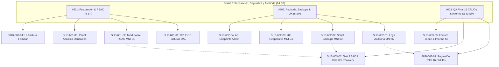

# Desglose de Subtareas Técnicas - Sprint 5: Facturación Familiar, Seguridad RBAC, Auditoría y Resguardos

> **Proyecto:** EduCare Kids — Sistema Integral de Centro Infantil y Pedagógico  
> **Documento Vinculado:** [← Volver a Sprint_5.md](./Sprint_5.md) | [📋 Índice General del Backlog](./README.md)  
> **Sprint:** `Sprint 5` (07/01/2027 – 20/01/2027) | **Velocidad Total del Sprint:** 14 Story Points  
> **Metodología:** Solo-Scrum | **Entorno Tecnológico:** React/Next.js, Node.js/TypeScript, SQLite 3FN, Jest/Vitest  

---

## 📌 Resumen Ejecutivo de Subtareas del Sprint 5

En este sprint se culmina el desarrollo del software de EduCare Kids, completando el **100% de los 16 mantenimientos CRUD** e integrando los requisitos no funcionales críticos: **Facturación Familiar**, **Seguridad y Control de Acceso por Roles (RBAC - MNF01)**, **Auditoría Inmutable de Eventos (MNF02)**, **Copias de Seguridad y Recuperación de SQLite (MNF03)** y **Optimización de Usabilidad Adaptativa (MNF04)**. Las 3 incidencias (HU 601, Tarea 602 y Tarea 603) se desglosan en **11 Subtareas Técnicas (`Sub-tasks`)**, sumando 44 horas de esfuerzo:

| ID Subtarea | Tarea / HU Padre | Título de la Subtarea Técnica | Capa / Módulo | Est. Horas | Estado |
| :---: | :---: | :--- | :---: | :---: | :---: |
| **SUB-601-01** | [#601](./Sprint_5.md#31-jira-id-601-facturación-familiar-analítica-de-ocupación-y-control-de-acceso-por-roles-rbac-m08mnf01---crud-16) | Repositorio y Servicio CRUD 16 (`facturas_usuarios`) con Desglose Transparente | Backend / DAL (M08) | 4 h | 🟩 Completado |
| **SUB-601-02** | [#601](./Sprint_5.md#31-jira-id-601-facturación-familiar-analítica-de-ocupación-y-control-de-acceso-por-roles-rbac-m08mnf01---crud-16) | Middleware de Seguridad y Autorización RBAC (`authMiddleware.ts` - MNF01) | Seguridad / Core | 4 h | 🟩 Completado |
| **SUB-601-03** | [#601](./Sprint_5.md#31-jira-id-601-facturación-familiar-analítica-de-ocupación-y-control-de-acceso-por-roles-rbac-m08mnf01---crud-16) | Panel de Analítica e Indicadores Estadísticos de Ocupación e Ingresos | Frontend / UI (M08) | 5 h | 🟩 Completado |
| **SUB-601-04** | [#601](./Sprint_5.md#31-jira-id-601-facturación-familiar-analítica-de-ocupación-y-control-de-acceso-por-roles-rbac-m08mnf01---crud-16) | Módulo de Visualización y Descarga de Facturas para Familias | Frontend / UI (M08) | 4 h | 🟩 Completado |
| **SUB-602-01** | [#602](./Sprint_5.md#32-jira-id-602-auditoría-de-eventos-logs-resguardos-automáticos-sqlite-backups-y-refactorización-de-usabilidad-adaptativa-mnf02-mnf03-mnf04) | Subsistema Inmutable de Auditoría de Eventos Críticos (MNF02) | Backend / Seguridad | 4 h | 🟩 Completado |
| **SUB-602-02** | [#602](./Sprint_5.md#32-jira-id-602-auditoría-de-eventos-logs-resguardos-automáticos-sqlite-backups-y-refactorización-de-usabilidad-adaptativa-mnf02-mnf03-mnf04) | Scripts Automatizados de Backup y Restauración de SQLite (`VACUUM INTO` - MNF03) | Infraestructura / BD | 4 h | 🟩 Completado |
| **SUB-602-03** | [#602](./Sprint_5.md#32-jira-id-602-auditoría-de-eventos-logs-resguardos-automáticos-sqlite-backups-y-refactorización-de-usabilidad-adaptativa-mnf02-mnf03-mnf04) | Refactorización de Usabilidad Adaptativa Responsive (Mobile/Desktop - MNF04) | Frontend / UX | 4 h | 🟩 Completado |
| **SUB-602-04** | [#602](./Sprint_5.md#32-jira-id-602-auditoría-de-eventos-logs-resguardos-automáticos-sqlite-backups-y-refactorización-de-usabilidad-adaptativa-mnf02-mnf03-mnf04) | Endpoints Protegidos de Administración para Logs, Backups y Estadísticas | Backend / API | 3 h | 🟩 Completado |
| **SUB-603-01** | [#603](./Sprint_5.md#33-jira-id-603-validación-sprint-5-certificación-de-regresión-final-de-los-16-cruds-y-redacción-del-último-informe-de-avance-sprint-5) | Suite de Regresión Total Automatizada de los 16 CRUDs en 3FN (PRU-01..06) | QA / Regresión Total | 5 h | 🟩 Completado |
| **SUB-603-02** | [#603](./Sprint_5.md#33-jira-id-603-validación-sprint-5-certificación-de-regresión-final-de-los-16-cruds-y-redacción-del-último-informe-de-avance-sprint-5) | Pruebas de Violación de Políticas RBAC y Recuperación ante Desastres | QA / Seguridad & DR | 3 h | 🟩 Completado |
| **SUB-603-03** | [#603](./Sprint_5.md#33-jira-id-603-validación-sprint-5-certificación-de-regresión-final-de-los-16-cruds-y-redacción-del-último-informe-de-avance-sprint-5) | Congelación de Código (*Feature Freeze*) y Redacción del Último Informe de Avance | Gestión / Académico | 4 h | 🟩 Completado |
| **TOTAL** | **3 Ítems Padre** | **11 Subtareas Técnicas Detalladas** | **Cobertura M08 y MNF01..04** | **44 h** | **Listo para Cierre** |

---

## 🛠️ Mapa de Arquitectura de Seguridad y Auditoría (Sprint 5)

---

### 1. Ítem Padre: [#601] Facturación familiar, analítica de ocupación y control de acceso por roles RBAC (M08/MNF01 - CRUD 16)
* **Tipo:** `Historia de Usuario` | **Estimación:** 6 SP | **Prioridad:** High
* **Rol:** Administrador y Padre/Tutor
* **Épica Padre:** Épica 5 (`EP05: Facturación, Analítica, Seguridad RBAC, Auditoría y Resguardos`)

#### Subtarea `SUB-601-01`: Repositorio y Servicio CRUD 16 (`facturas_usuarios`) con Desglose Transparente
* **Tipo:** Subtarea Técnica (`Sub-task`)
* **Estimación de Esfuerzo:** 4 horas
* **Capa:** Backend / DAL (M08)
* **Descripción Detallada:**
  - Implementación de `FacturaRepository.ts` y `FacturaService.ts` operando sobre `facturas_usuarios`:
    - **CREATE:** Generación de factura con número correlativo único (`FAC-2027-XXXX`), asociada a `id_familia` y `id_cita`:
      - Desglose de importe base de servicio.
      - Desglose de recargo dinámico por edad (+30% lactante o +15% infantil).
      - Suplemento de desplazamiento kilométrico (CRUD 09).
      - Indicador de deducción por bono prepago (si aplica).
      - Total bruto, IVA y total neto facturado.
    - **READ:** Consulta de extractos familiares (padres solo ven sus facturas; administrador ve facturación global).
    - **UPDATE:** Rectificación o marcado de estado (`PAGADA`, `EMITIDA`, `ANULADA`).
    - **DELETE:** Anulación contable lógica (prohibido borrado físico en base de datos fiscal).
* **Criterios de Aceptación Técnicos:**
  - Inmutabilidad de los importes una vez emitida la factura.

---

#### Subtarea `SUB-601-02`: Middleware de Seguridad y Autorización RBAC (`authMiddleware.ts` - MNF01)
* **Tipo:** Subtarea Técnica (`Sub-task`)
* **Estimación de Esfuerzo:** 4 horas
* **Capa:** Seguridad / Core de la Aplicación
* **Descripción Detallada:**
  - Creación del middleware de control de acceso basado en roles (RBAC) en `src/middleware/rbacMiddleware.ts`:
    - Definición de roles formales:
      - **Rol `PADRES`:** Permisos restringidos exclusivamente a su núcleo familiar (ver sus hijos, alérgenos, reservar citas, ver su monedero y descargar sus facturas).
      - **Rol `ADMINISTRADOR`:** Acceso integral a configuración de sede (CRUD 15), catálogo de tarifas (CRUD 05), agenda global, visor de auditoría, disparador de backups y analítica.
    - Interceptación de rutas API y páginas Next.js (`/admin/*` vs `/portal-familias/*`).
    - Bloqueo inmediato con código HTTP 403 Forbidden si un usuario con rol `PADRES` intenta invocar endpoints administrativos.
* **Criterios de Aceptación Técnicos:**
  - Aislamiento multi-inquilino (*tenant*) estricto: un padre no puede consultar la URL `/api/facturas/123` si la factura pertenece a otra familia.

---

#### Subtarea `SUB-601-03`: Panel de Analítica e Indicadores Estadísticos de Ocupación e Ingresos
* **Tipo:** Subtarea Técnica (`Sub-task`)
* **Estimación de Esfuerzo:** 5 horas
* **Capa:** Frontend / UI (React/Next.js)
* **Descripción Detallada:**
  - Componentes en `src/components/analitica/`:
    - `OccupancyStatsCard.tsx`: Porcentaje de ocupación de franjas horarias del centro por día y semana.
    - `RevenueBreakdownChart.tsx`: Gráfica interactiva de ingresos discriminando por modalidad (Niñera a domicilio, Clases presenciales, Online, Tutoría asíncrona y venta de Bonos).
    - Métricas de kilómetros promedio recorridos en servicios presenciales.
* **Criterios de Aceptación Técnicos:**
  - Visualización clara y reactiva con consultas agregadas en SQLite (`SUM()`, `AVG()`, `COUNT()`).

---

#### Subtarea `SUB-601-04`: Módulo de Visualización y Descarga de Facturas para Familias
* **Tipo:** Subtarea Técnica (`Sub-task`)
* **Estimación de Esfuerzo:** 4 horas
* **Capa:** Frontend / UI
* **Descripción Detallada:**
  - Desarrollo de `FacturaDetailView.tsx` y utilidad de impresión/PDF:
    - Vista estructurada con cabecera legal de EduCare Kids, datos fiscales de la familia y desglose pormenorizado de horas, suplemento vial y total.
    - Botón para descarga de extracto en formato imprimible o PDF ligero.
* **Criterios de Aceptación Técnicos:**
  - El diseño de la factura se ajusta a formato estándar DIN A4 en impresión.

---

### 2. Ítem Padre: [#602] Auditoría de eventos (logs), resguardos automáticos SQLite (backups) y refactorización de usabilidad adaptativa (MNF02, MNF03, MNF04)
* **Tipo:** `Tarea` (Estructurada como HU) | **Estimación:** 5 SP | **Prioridad:** High
* **Rol:** Administrador del Sistema
* **Épica Padre:** Épica 5 (`EP05: Facturación, Analítica, Seguridad RBAC, Auditoría y Resguardos`)

#### Subtarea `SUB-602-01`: Subsistema Inmutable de Auditoría de Eventos Críticos (MNF02)
* **Tipo:** Subtarea Técnica (`Sub-task`)
* **Estimación de Esfuerzo:** 4 horas
* **Capa:** Backend / Seguridad y Auditoría
* **Descripción Detallada:**
  - Implementación de `AuditLoggerService.ts` operando sobre la tabla de auditoría:
    - Registro inmutable de eventos con: `id_log`, `timestamp` (UTC ISO-8601), `id_usuario`, `rol`, `tipo_evento`, `descripcion_detallada`, `ip_origen`.
    - Eventos auditados obligatoriamente:
      - Alertas de saldo crítico de bonos $\le 2\text{h}$ disparadas por P03.
      - Modificaciones de tarifas o radio de sede por el administrador.
      - Intentos de acceso no autorizado bloqueados por el middleware RBAC.
      - Disparo de copias de seguridad de la base de datos.
    - Visor administrativo protegido con filtros cronológicos y de severidad.
* **Criterios de Aceptación Técnicos:**
  - La tabla de auditoría no admite operaciones `UPDATE`; solo admite `INSERT` y consultas `SELECT`.

---

#### Subtarea `SUB-602-02`: Scripts Automatizados de Backup y Restauración de SQLite (`VACUUM INTO` - MNF03)
* **Tipo:** Subtarea Técnica (`Sub-task`)
* **Estimación de Esfuerzo:** 4 horas
* **Capa:** Infraestructura / Base de Datos
* **Descripción Detallada:**
  - Creación de utilidades de línea de comandos y servicios en `src/infrastructure/backup/`:
    - `backupDatabase.ts`: Utiliza la directiva nativa de SQLite `VACUUM INTO 'backups/backup_educare_YYYYMMDD_HHmmss.sqlite';` para generar una instantánea completa, consistente y no bloqueante en caliente.
    - `restoreDatabase.ts`: Script de recuperación que valida la integridad del archivo de respaldo (verificando `PRAGMA integrity_check;`) antes de reemplazar la base activa.
  - Generación de comandos en `package.json`: `npm run db:backup` y `npm run db:restore`.
* **Criterios de Aceptación Técnicos:**
  - Copia consistente generada sin detener el servidor ni provocar bloqueos en lecturas/escrituras concurrentes.

---

#### Subtarea `SUB-602-03`: Refactorización de Usabilidad Adaptativa Responsive (Mobile/Desktop - MNF04)
* **Tipo:** Subtarea Técnica (`Sub-task`)
* **Estimación de Esfuerzo:** 4 horas
* **Capa:** Frontend / UX / Accesibilidad
* **Descripción Detallada:**
  - Revisión exhaustiva de todas las vistas de la aplicación bajo directrices responsive:
    - Breakpoints móviles (360px a 480px): Menús de navegación tipo *drawer*, calendarios con vista compacta de lista por día, tablas con desplazamiento horizontal o tarjetas colapsables.
    - Breakpoints de tablet y escritorio (768px a 1440px+): Cuadrícula completa semanal, paneles laterales de información y tablas analíticas con paginación fluida.
  - Optimización de rendimiento de carga y tiempos de interacción (First Contentful Paint $< 1.2\text{s}$).
* **Criterios de Aceptación Técnicos:**
  - La aplicación es plenamente operativa y cómoda de utilizar tanto desde un smartphone de un padre como desde el monitor del centro.

---

#### Subtarea `SUB-602-04`: Endpoints Protegidos de Administración para Logs, Backups y Estadísticas
* **Tipo:** Subtarea Técnica (`Sub-task`)
* **Estimación de Esfuerzo:** 3 horas
* **Capa:** Backend / API
* **Descripción Detallada:**
  - Desarrollo de rutas administrativas en Next.js App Router:
    - `GET /api/admin/audit-logs`: Listado paginado de logs.
    - `POST /api/admin/backups/create`: Dispara el backup en caliente bajo demanda.
    - `GET /api/admin/analytics`: Estadísticas agregadas de ocupación y facturación.
  - Protección estricta con middleware RBAC comprobando credenciales de Administrador.
* **Criterios de Aceptación Técnicos:**
  - Respuestas JSON rápidas y seguras.

---

### 3. Ítem Padre: [#603] [VALIDACIÓN SPRINT 5] Certificación de regresión final de los 16 CRUDs y redacción del último Informe de Avance Sprint 5
* **Tipo:** `Tarea` (Estructurada como HU) | **Estimación:** 3 SP | **Prioridad:** Highest
* **Rol:** Responsable de QA
* **Épica Padre:** Épica 6 (`Plan de Validación Continua por Sprint, Calidad (QA), Informes y Entrega Final`)

#### Subtarea `SUB-603-01`: Suite de Regresión Total Automatizada de los 16 CRUDs en 3FN (PRU-01..06)
* **Tipo:** Subtarea Técnica (`Sub-task`)
* **Estimación de Esfuerzo:** 5 horas
* **Capa:** QA / Regresión Total
* **Descripción Detallada:**
  - Ejecución de la suite completa consolidada de pruebas automatizadas en Jest/Vitest:
    - Verificación de los 16 CRUDs relacionales funcionando en armonía:
      `familias`, `menores`, `alergenos_menores`, `servicios`, `tarifas_edad`, `materias_apoyo`, `citas`, `franjas_horarias`, `zonas_desplazamiento`, `bloqueos_viales`, `catalogo_bonos`, `bonos_familias`, `entregas_tutoria`, `registros_cuidados`, `configuracion_sede` y `facturas_usuarios`.
    - Comprobación de que no existen regresiones tras incorporar facturación y seguridad.
* **Criterios de Aceptación Técnicos:**
  - 100% de tests en verde (`0 failed`) con reporte de aserciones completado.

---

#### Subtarea `SUB-603-02`: Pruebas de Violación de Políticas RBAC y Recuperación ante Desastres
* **Tipo:** Subtarea Técnica (`Sub-task`)
* **Estimación de Esfuerzo:** 3 horas
* **Capa:** QA / Seguridad y Resiliencia
* **Descripción Detallada:**
  - Suite de seguridad `test/qa/security_rbac_and_backup.test.ts`:
    - Prueba 1 (RBAC): Simular petición con token de usuario `PADRES` al endpoint `/api/admin/backups/create` ➔ Debe recibir HTTP 403 Forbidden y registrarse el intento en la tabla de auditoría.
    - Prueba 2 (Disaster Recovery): Crear datos de prueba ➔ Ejecutar backup ➔ Corromper intencionadamente la base de datos ➔ Restaurar backup ➔ Comprobar integridad del 100% de los registros mediante `PRAGMA integrity_check;`.
* **Criterios de Aceptación Técnicos:**
  - Las políticas de seguridad se cumplen categóricamente y el plan de recuperación es viable.

---

#### Subtarea `SUB-603-03`: Congelación de Código (*Feature Freeze*) y Redacción del Último Informe de Avance
* **Tipo:** Subtarea Técnica (`Sub-task`)
* **Estimación de Esfuerzo:** 4 horas
* **Capa:** Gestión Ágil / Académica
* **Descripción Detallada:**
  - Declaración formal del *Feature Freeze*: no se aceptan nuevas características de desarrollo; el software queda estabilizado para la fase de Release.
  - Redacción del *Informe de Avance del Sprint 5*:
    - Velocidad lograda: **14 Story Points** (acumulado de 81 SP completados en el desarrollo de los Sprints 0 al 5).
    - Certificación del 100% de requerimientos funcionales y no funcionales (M01 a M08 y MNF01 a MNF04).
    - Planificación de la **Entrega Final (Release)** (Memoria técnica, vídeo demo y certificación VIU con 13 SP).
* **Criterios de Aceptación Técnicos:**
  - Último informe quincenal aprobado y archivado formalmente.

---

## 📋 Checklist de Certificación del Sprint 5 (Definition of Done)

- [x] **SUB-601-01 a SUB-601-04:** CRUD 16 (`facturas_usuarios`), middleware RBAC (Padres vs Administrador), analítica visual y visor de facturas operativos.
- [x] **SUB-602-01 a SUB-602-04:** Auditoría inmutable (MNF02), scripts de backup/restore SQLite (MNF03), refactorización responsive (MNF04) y endpoints de administración terminados.
- [x] **SUB-603-01 a SUB-603-03:** Regresión total de los 16 CRUDs en 3FN, certificación RBAC y DR, Feature Freeze y último Informe de Avance emitido.
- [x] **Integridad Total:** 81 Story Points acumulados cerrando oficialmente toda la fase de construcción de software.

---
*Archivo generado para el seguimiento granular de tareas técnicas del Sprint 5 en el proyecto EduCare Kids.*

