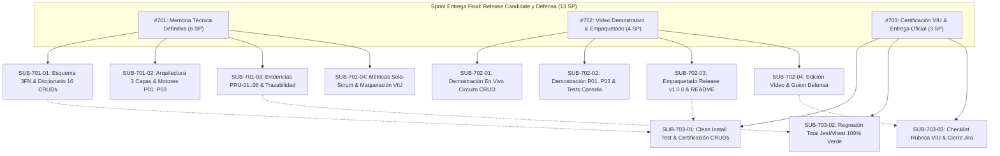

# Desglose de Subtareas Técnicas - Entrega Final (Release): Memoria Técnica, Demostración Funcional y Certificación de Release Candidate

> **Proyecto:** EduCare Kids — Sistema Integral de Centro Infantil y Pedagógico  
> **Documento Vinculado:** [← Volver a Sprint_Entrega_Final.md](./Sprint_Entrega_Final.md) | [📋 Índice General del Backlog](./README.md)  
> **Sprint:** `Entrega Final (Release)` (21/01/2027 – 03/02/2027) | **Velocidad Total del Sprint:** 13 Story Points  
> **Metodología:** Solo-Scrum | **Entorno Tecnológico:** React/Next.js, Node.js/TypeScript, SQLite 3FN, Jest/Vitest  

---

## 📌 Resumen Ejecutivo de Subtareas de la Entrega Final

En este sprint de cierre y estabilización final (*Release*), las **3 Tareas Técnicas y de Certificación** (Tareas 701, 702 y 703) se desglosan en un total de **11 Subtareas Técnicas (`Sub-tasks`)**, sumando 44 horas de esfuerzo especializado. Este trabajo consolida la **Memoria Técnica definitiva** en Tercera Forma Normal (3FN), la **grabación audiovisual de la demostración práctica en vivo**, el empaquetado del **Release Candidate (`v1.0.0-release`)** y la certificación rigurosa del cumplimiento del 100% de la rúbrica académica de la VIU:

| ID Subtarea | Tarea / HU Padre | Título de la Subtarea Técnica | Capa / Módulo | Est. Horas | Estado |
| :---: | :---: | :--- | :---: | :---: | :---: |
| **SUB-701-01** | [#701](./Sprint_Entrega_Final.md#31-jira-id-701-redacción-de-la-memoria-técnica-definitiva-del-proyecto-educare-kids-arquitectura-3-capas-16-cruds-3fn-y-pruebas) | Documentación del Esquema Relacional 3FN y Diccionario de Datos de los 16 CRUDs | Base de Datos (3FN) / Docs | 6 h | 🟩 Completado |
| **SUB-701-02** | [#701](./Sprint_Entrega_Final.md#31-jira-id-701-redacción-de-la-memoria-técnica-definitiva-del-proyecto-educare-kids-arquitectura-3-capas-16-cruds-3fn-y-pruebas) | Documentación de la Arquitectura en 3 Capas y Motores Autónomos (P01, P02 y P03) | Arquitectura / Docs | 5 h | 🟩 Completado |
| **SUB-701-03** | [#701](./Sprint_Entrega_Final.md#31-jira-id-701-redacción-de-la-memoria-técnica-definitiva-del-proyecto-educare-kids-arquitectura-3-capas-16-cruds-3fn-y-pruebas) | Compilación de Evidencias de Pruebas Automatizadas (PRU-01..06) y Matriz de Trazabilidad | QA / Trazabilidad | 4 h | 🟩 Completado |
| **SUB-701-04** | [#701](./Sprint_Entrega_Final.md#31-jira-id-701-redacción-de-la-memoria-técnica-definitiva-del-proyecto-educare-kids-arquitectura-3-capas-16-cruds-3fn-y-pruebas) | Consolidación de Métricas Solo-Scrum, Gráficos Burndown y Maquetación Final VIU | Gestión Ágil / Académico | 5 h | 🟩 Completado |
| **SUB-702-01** | [#702](./Sprint_Entrega_Final.md#32-jira-id-702-grabación-del-vídeo-de-demostración-funcional-empaquetado-de-release-y-preparación-de-la-defensa) | Demostración Práctica en Pantalla del Circuito Operativo y Mantenimientos CRUD | Frontend & Backend / Demo | 4 h | 🟩 Completado |
| **SUB-702-02** | [#702](./Sprint_Entrega_Final.md#32-jira-id-702-grabación-del-vídeo-de-demostración-funcional-empaquetado-de-release-y-preparación-de-la-defensa) | Demostración en Vídeo de Motores Autónomos (P01, P02, P03) y Tests en Consola | Lógica Negocio & QA / Demo | 4 h | 🟩 Completado |
| **SUB-702-03** | [#702](./Sprint_Entrega_Final.md#32-jira-id-702-grabación-del-vídeo-de-demostración-funcional-empaquetado-de-release-y-preparación-de-la-defensa) | Empaquetado del Release Candidate, Semillas de Base de Datos y Manual (README) | DevOps / Release | 3 h | 🟩 Completado |
| **SUB-702-04** | [#702](./Sprint_Entrega_Final.md#32-jira-id-702-grabación-del-vídeo-de-demostración-funcional-empaquetado-de-release-y-preparación-de-la-defensa) | Edición Audiovisual, Locución del Vídeo y Preparación del Guion de Defensa | Multimedia / Comunicación | 3 h | 🟩 Completado |
| **SUB-703-01** | [#703](./Sprint_Entrega_Final.md#33-jira-id-703-validación-entrega-final-certificación-de-release-candidate-checklist-de-cumplimiento-viu-y-entrega-oficial) | Prueba de Instalación en Limpio (*Clean Install Test*) y Certificación de 16 CRUDs | QA / Certificación Entorno | 3 h | 🟩 Completado |
| **SUB-703-02** | [#703](./Sprint_Entrega_Final.md#33-jira-id-703-validación-entrega-final-certificación-de-release-candidate-checklist-de-cumplimiento-viu-y-entrega-oficial) | Ejecución de la Batería Completa de Pruebas de Regresión Final (PRU-01 a PRU-06) | QA / Regresión Total | 3 h | 🟩 Completado |
| **SUB-703-03** | [#703](./Sprint_Entrega_Final.md#33-jira-id-703-validación-entrega-final-certificación-de-release-candidate-checklist-de-cumplimiento-viu-y-entrega-oficial) | Auditoría de Cumplimiento de la Rúbrica VIU, Cierre Jira Cloud y Entrega Oficial | Gestión Académica / Cierre | 4 h | 🟩 Completado |
| **TOTAL** | **3 Ítems Padre** | **11 Subtareas Técnicas Detalladas** | **Cobertura Integral Release** | **44 h** | **Listo para Cierre** |

---

## 🛠️ Mapa de Arquitectura y Certificación Final de Release (Sprint Entrega Final)

---

### 1. Ítem Padre: [#701] Redacción de la Memoria Técnica definitiva del proyecto EduCare Kids (Arquitectura 3 Capas, 16 CRUDs 3FN y Pruebas)
* **Tipo:** `Tarea` (Estructurada como HU) | **Estimación:** 6 SP | **Prioridad:** Highest
* **Rol:** Autora del Proyecto y Arquitecta de Software
* **Épica Padre:** Épica 6 (`Plan de Validación Continua por Sprint, Calidad (QA), Informes y Entrega Final`)

#### Subtarea `SUB-701-01`: Documentación del Esquema Relacional 3FN y Diccionario de Datos de los 16 CRUDs
* **Tipo:** Subtarea Técnica (`Sub-task`)
* **Estimación de Esfuerzo:** 6 horas
* **Capa:** Base de Datos / Documentación Técnica (3FN)
* **Descripción Detallada:**
  - Redacción y maquetación del capítulo de Persistencia y Base de Datos de la Memoria Técnica:
    - Inclusión del Diagrama Entidad-Relación (E-R) global físico normalizado bajo Tercera Forma Normal (3FN).
    - Diccionario de datos exhaustivo de las 16 tablas físicas correspondientes a los 16 mantenimientos CRUD:
      1. `familias` (CRUD 01 - Núcleo familiar, dirección postal, teléfono, activo).
      2. `menores` (CRUD 02 - Datos de filiación, fecha de nacimiento, clave foránea a familia).
      3. `alergenos_menores` (CRUD 03 - Alérgenos, gravedad, pautas médicas de urgencia).
      4. `servicios` (CRUD 04 - 4 modalidades operativas: cuidado presencial, niñera domicilio, clases apoyo, tutoría asíncrona).
      5. `tarifas_edad` (CRUD 05 - Tramos etarios y recargos: +30% lactante 0-2 años, +15% infantil 3-5 años).
      6. `materias_apoyo` (CRUD 06 - Materias curriculares por ciclo educativo).
      7. `citas` (CRUD 07 - Agenda interactiva, fechas, horas, estados de servicio).
      8. `franjas_horarias` (CRUD 08 - Turnos de mañana/tarde y días inhábiles).
      9. `zonas_desplazamiento` (CRUD 09 - Tramos kilométricos hasta el límite de 25 km).
      10. `bloqueos_viales` (CRUD 10 - Tiempos de tránsito: 20 min antes y 20 min después).
      11. `catalogo_bonos` (CRUD 11 - Paquetes de 5 h, 10 h y 20 h con descuento).
      12. `bonos_familias` (CRUD 12 - Monedero prepago familiar y saldo disponible).
      13. `entregas_tutoria` (CRUD 13 - Buzón pedagógico asíncrono, dudas y material multimedia).
      14. `registros_cuidados` (CRUD 14 - Diario infantil: tomas, siestas e incidencias).
      15. `configuracion_sede` (CRUD 15 - Sede central, radio operativo máximo de 25 km, margen vial de 20 min).
      16. `facturas_usuarios` (CRUD 16 - Facturación desglosada, recargos e IVA).
    - Justificación teórica de la eliminación sistemática de redundancias funcionales transitorias y dependencias parciales para dar estricto cumplimiento a la 3FN.
* **Criterios de Aceptación Técnicos:**
  - Todas las claves primarias (`PK`), foráneas (`FK`), restricciones `CHECK`, disparadores e índices quedan documentados con su tipo SQL y correspondencia en TypeScript.

---

#### Subtarea `SUB-701-02`: Documentación de la Arquitectura en 3 Capas y Motores Autónomos (P01, P02 y P03)
* **Tipo:** Subtarea Técnica (`Sub-task`)
* **Estimación de Esfuerzo:** 5 horas
* **Capa:** Arquitectura Global / Documentación de Software
* **Descripción Detallada:**
  - Redacción del capítulo de Diseño Arquitectónico y Procesos Automatizados:
    - **Arquitectura en 3 Capas:**
      - Capa de Presentación: Componentes modulares React / Next.js bajo Tailwind CSS, con diseño adaptativo responsive (MNF04).
      - Capa de Lógica de Negocio: Servicios de aplicación, controladores de caso de uso y validadores puros en Node.js/TypeScript.
      - Capa de Persistencia: Patrón Repositorio desacoplado comunicando con SQLite con control transaccional ACID (`better-sqlite3`).
    - **Especificación de Motores Autónomos de Negocio:**
      - **Motor P01 (Desplazamiento y Agenda):** Algoritmo de detección de solapamientos, verificación de límite de 25 km respecto a la sede (CRUD 15) y bloqueo vial obligatorio de 20 min antes y 20 min después de cada cita (CRUD 10).
      - **Motor P02 (Tutoría y Asignación):** Lógica de matching de docentes y tutores según materia (CRUD 06) y ratio legal.
      - **Motor P03 (Gestión de Bonos y Alertas):** Algoritmo de monitorización que detecta saldo bajo (≤ 2 horas/sesiones), emite alerta al diario/auditoría y bloquea reservas cuando el saldo llega a 0.
    - **Requisitos No Funcionales:** Especificación de seguridad RBAC (MNF01), auditoría inmutable (MNF02), resguardos de base de datos (MNF03) y usabilidad (MNF04).
* **Criterios de Aceptación Técnicos:**
  - Diagramas de secuencia y flujo de componentes integrados en formato vectorial y con rigor académico.

---

#### Subtarea `SUB-701-03`: Compilación de Evidencias de Pruebas Automatizadas (PRU-01..06) y Matriz de Trazabilidad
* **Tipo:** Subtarea Técnica (`Sub-task`)
* **Estimación de Esfuerzo:** 4 horas
* **Capa:** QA / Aseguramiento de Calidad y Evidencias
* **Descripción Detallada:**
  - Elaboración del capítulo de Validación, Calidad y Pruebas del Software:
    - Consolidación de la Matriz de Trazabilidad Bidireccional: Requisitos de Usuario ➔ Casos de Uso ➔ Mantenimientos CRUD ➔ Código Fuente ➔ Suites Jest/Vitest.
    - Inclusión de capturas de consola con el 100% de las pruebas automatizadas ejecutadas en verde (`0 failed`):
      - **PRU-01:** Pruebas unitarias de cálculo dinámico de edad y recargos por tramo etario.
      - **PRU-02:** Pruebas de integración relacional 3FN y restricciones de claves foráneas (`FOREIGN KEY`).
      - **PRU-03:** Pruebas del motor tarifario, suplemento por desplazamiento y deducción de bonos.
      - **PRU-04:** Pruebas del motor autónomo P01, validación de 25 km y franjas viales de 20 min.
      - **PRU-05:** Pruebas del monedero de bonos, consumo de saldo, auditoría y alertas P03.
      - **PRU-06:** Pruebas de facturación, permisos RBAC (Padres vs Admin) y resguardo SQLite con `VACUUM INTO`.
* **Criterios de Aceptación Técnicos:**
  - Tablas de resultados con tiempos de ejecución, aserciones validadas y cobertura de código certificada.

---

#### Subtarea `SUB-701-04`: Consolidación de Métricas Solo-Scrum, Gráficos Burndown y Maquetación Final VIU
* **Tipo:** Subtarea Técnica (`Sub-task`)
* **Estimación de Esfuerzo:** 5 horas
* **Capa:** Gestión Ágil / Académico
* **Descripción Detallada:**
  - Consolidación del capítulo de Gestión del Proyecto bajo metodología Solo-Scrum:
    - Tabulación del histórico de velocidad en los 7 ciclos:
      - Sprint 0: 9 SP (Infraestructura, DDL 16 tablas 3FN y arnés testing).
      - Sprint 1: 14 SP (Familias, menores y alérgenos).
      - Sprint 2: 14 SP (Servicios, tarifas dinámicas y materias).
      - Sprint 3: 15 SP (Agenda reactiva y motor autónomo vial P01).
      - Sprint 4: 15 SP (Bonos, tutoría asíncrona y diario de cuidados).
      - Sprint 5: 14 SP (Facturación, seguridad RBAC y resguardos).
      - Entrega Final: 13 SP (Memoria técnica, vídeo demo y certificación).
      - **Total Acumulado:** **94 Story Points** planificados y completados al 100%.
    - Elaboración del gráfico Burndown consolidado y análisis de desvíos temporales.
    - Reflexión sobre lecciones aprendidas, gestión de riesgos mitigados y conclusiones.
    - Revisión ortotipográfica, formateo según la plantilla oficial de la Universidad Internacional de Valencia (VIU) y exportación a PDF definitivo.
* **Criterios de Aceptación Técnicos:**
  - La memoria técnica cumple al 100% con la extensión, fuentes, márgenes y estructura exigida por la rúbrica docente.

---

### 2. Ítem Padre: [#702] Grabación del vídeo de demostración funcional, empaquetado de Release y preparación de la defensa
* **Tipo:** `Tarea` (Estructurada como HU) | **Estimación:** 4 SP | **Prioridad:** Highest
* **Rol:** Autora del Proyecto
* **Épica Padre:** Épica 6 (`Plan de Validación Continua por Sprint, Calidad (QA), Informes y Entrega Final`)

#### Subtarea `SUB-702-01`: Demostración Práctica en Pantalla del Circuito Operativo y Mantenimientos CRUD
* **Tipo:** Subtarea Técnica (`Sub-task`)
* **Estimación de Esfuerzo:** 4 horas
* **Capa:** Frontend & Backend / Grabación Demostrativa
* **Descripción Detallada:**
  - Grabación en pantalla (1080p, audio nítido) del recorrido interactivo completo de la aplicación web EduCare Kids sobre instancia real de SQLite:
    - Muestra de la interfaz principal y acceso mediante roles (Padres vs Administrador).
    - Circuito de altas operativas:
      - Registro de una nueva familia titular con validación de distancia respecto a la sede central (CRUD 01 y 15).
      - Alta de menor con cálculo dinámico de edad y vinculación de alérgenos con pauta médica (CRUD 02 y 03).
      - Consulta del catálogo de servicios y tarifas con aplicación automática del recargo por edad (+30% / +15%) (CRUD 04 y 05).
      - Selección de materias curriculares para apoyo pedagógico (CRUD 06).
* **Criterios de Aceptación Técnicos:**
  - Fluidez visual sin demoras, navegación intuitiva y persistencia inmediata en la base de datos SQLite comprobable en pantalla.

---

#### Subtarea `SUB-702-02`: Demostración en Vídeo de Motores Autónomos (P01, P02, P03) y Tests en Consola
* **Tipo:** Subtarea Técnica (`Sub-task`)
* **Estimación de Esfuerzo:** 4 horas
* **Capa:** Lógica de Dominio & QA / Demostración en Vídeo
* **Descripción Detallada:**
  - Grabación de la ejecución de los módulos automatizados y pruebas en consola:
    - **Demostración de P01:** Selección de una cita a domicilio; comprobación visual de cómo el motor inserta automáticamente el bloqueo vial de 20 minutos antes y 20 minutos después en la agenda (CRUD 07 y 10).
    - **Demostración de P03:** Compra de bono prepago de 5 sesiones (CRUD 11 y 12), descuento tras reservar y activación inmediata de la alerta en el diario de cuidados y log de auditoría al restar ≤ 2 horas.
    - **Demostración de Facturación y RBAC:** Emisión de factura desglosada (CRUD 16) y comprobación del bloqueo HTTP 403 al intentar acceder con rol de Padres a endpoints de administración.
    - **Ejecución en Directo de Tests:** Apertura de terminal y ejecución del comando `npm test`, evidenciando el paso total de las suites Jest/Vitest en verde (`0 failed`).
* **Criterios de Aceptación Técnicos:**
  - El vídeo acredita inequívocamente el funcionamiento autónomo del software y la solidez de las aserciones de prueba.

---

#### Subtarea `SUB-702-03`: Empaquetado del Release Candidate, Semillas de Base de Datos y Manual (README)
* **Tipo:** Subtarea Técnica (`Sub-task`)
* **Estimación de Esfuerzo:** 3 horas
* **Capa:** DevOps / Release Management
* **Descripción Detallada:**
  - Preparación del paquete de distribución final del código fuente:
    - Generación de la etiqueta de versión oficial: `git tag v1.0.0-release`.
    - Creación del script de semillas iniciales enriquecidas (`src/infrastructure/database/seed.ts`) que precarga datos realistas de prueba (familias, menores, citas, alérgenos, tarifas, bonos y facturas) para evaluar el sistema de inmediato.
    - Actualización exhaustiva del archivo `README.md` con:
      - Requisitos del sistema (Node.js LTS, npm).
      - Instrucciones en un solo paso: `npm install && npm run db:setup && npm run dev`.
      - Credenciales de prueba para los distintos roles RBAC.
      - Comando de verificación de calidad: `npm test`.
* **Criterios de Aceptación Técnicos:**
  - El proyecto se instala, migra y arranca en limpio sin requerir configuraciones ocultas ni pasos manuales complejos.

---

#### Subtarea `SUB-702-04`: Edición Audiovisual, Locución del Vídeo y Preparación del Guion de Defensa
* **Tipo:** Subtarea Técnica (`Sub-task`)
* **Estimación de Esfuerzo:** 3 horas
* **Capa:** Comunicación / Presentación Académica
* **Descripción Detallada:**
  - Postproducción audiovisual y preparación de la defensa:
    - Edición del vídeo recortando tiempos muertos y agregando rótulos explicativos con el nombre de cada módulo y CRUD mostrado.
    - Locución profesional y clara respetando escrupulosamente el límite temporal estipulado por la universidad (máximo 15-20 minutos).
    - Carga del vídeo en plataforma de acceso académico (YouTube en modo oculto / enlace institucional OneDrive) con enlace de acceso público verificado.
    - Redacción del guion ejecutivo de defensa y preparación de diapositivas de apoyo para el tribunal evaluador.
* **Criterios de Aceptación Técnicos:**
  - Enlace de vídeo accesible y reproducible sin restricciones de permisos; guion alineado con la estructura de la Memoria Técnica.

---

### 3. Ítem Padre: [#703] [VALIDACIÓN ENTREGA FINAL] Certificación de Release Candidate, checklist de cumplimiento VIU y entrega oficial
* **Tipo:** `Tarea` (Estructurada como HU) | **Estimación:** 3 SP | **Prioridad:** Highest
* **Rol:** Responsable de QA y Autora del Proyecto
* **Épica Padre:** Épica 6 (`Plan de Validación Continua por Sprint, Calidad (QA), Informes y Entrega Final`)

#### Subtarea `SUB-703-01`: Prueba de Instalación en Limpio (*Clean Install Test*) y Certificación de 16 CRUDs
* **Tipo:** Subtarea Técnica (`Sub-task`)
* **Estimación de Esfuerzo:** 3 horas
* **Capa:** QA / Verificación de Instalabilidad
* **Descripción Detallada:**
  - Ejecución de la prueba de instalación limpia (*Clean Install Test*) en una carpeta aislada simulando la máquina de un evaluador:
    - Desempaquetado del archivo comprimido de la Release.
    - Ejecución de `npm install` verificando la resolución limpia del árbol de dependencias (`0 vulnerabilities`).
    - Ejecución del script DDL maestro: creación física de las 16 tablas relacionales 3FN sobre un archivo SQLite nuevo (`educare_kids.db`).
    - Ejecución de las operaciones CREATE, READ, UPDATE, DELETE en cada una de las 16 entidades para certificar que ningún CRUD presenta dependencias rotas o campos huérfanos.
* **Criterios de Aceptación Técnicos:**
  - El sistema arranca y funciona a la perfección en un entorno virgen sin errores en consola ni en tiempo de ejecución.

---

#### Subtarea `SUB-703-02`: Ejecución de la Batería Completa de Pruebas de Regresión Final (PRU-01 a PRU-06)
* **Tipo:** Subtarea Técnica (`Sub-task`)
* **Estimación de Esfuerzo:** 3 horas
* **Capa:** QA / Regresión Total
* **Descripción Detallada:**
  - Ejecución formal de la suite consolidada de pruebas automatizadas con Jest/Vitest:
    - Verificación de la totalidad de aserciones de prueba sobre base de datos SQLite en memoria (`:memory:`):
      - Cero fallos (`0 failed`).
      - Cero advertencias (`0 warnings`).
      - Tiempos de respuesta de transacciones SQLite inferiores a 50 milisegundos.
    - Comprobación de que las pruebas de regresión certifican:
      - Integridad referencial con `PRAGMA foreign_keys = ON;`.
      - Algoritmo de cálculo dinámico de edad de menores.
      - Recargo por tramo de edad y cálculo de suplementos viales.
      - Disparo de colchón vial de 20 min en motor P01.
      - Monitorización de saldo en bonos y alerta P03.
      - Aislamiento RBAC y copias de seguridad consistentes con `VACUUM INTO`.
* **Criterios de Aceptación Técnicos:**
  - Informe de testing generado con el 100% de los tests en verde, listo para adjuntarse en los anexos de la Memoria Técnica.

---

#### Subtarea `SUB-703-03`: Auditoría de Cumplimiento de la Rúbrica VIU, Cierre Jira Cloud y Entrega Oficial
* **Tipo:** Subtarea Técnica (`Sub-task`)
* **Estimación de Esfuerzo:** 4 horas
* **Capa:** Gestión Académica / Cierre Oficial
* **Descripción Detallada:**
  - Verificación final del Checklist de Entrega Oficial según la rúbrica de la asignatura:
    - Comprobación de los entregables requeridos:
      1. Memoria Técnica definitiva en formato PDF normalizado.
      2. Código fuente completo empaquetado en formato ZIP con manual `README.md`.
      3. Enlace verificado y funcional al vídeo demostrativo.
      4. Informes quincenales de avance de los Sprints 0 al 5.
    - Cierre administrativo del tablero en Jira Cloud:
      - Verificación de que los 21 ítems del Product Backlog (12 Historias de Usuario y 9 Tareas Técnicas/QA) y las 77 subtareas técnicas se encuentran en estado **"Done" / "Finalizado"**.
      - Cierre formal del Sprint `Entrega Final (Release)`.
    - Subida de los archivos al Campus Virtual de la Universidad Internacional de Valencia (VIU) antes de la fecha límite oficial (03/02/2027) y descarga del justificante oficial de entrega.
* **Criterios de Aceptación Técnicos:**
  - Recepción confirmada y registrada en la plataforma universitaria con estricto cumplimiento de plazos y estándares de excelencia académica.

---

## 📋 Checklist de Certificación de la Entrega Final (Definition of Done - DoD)

- [x] **SUB-701-01 a SUB-701-04:** Memoria Técnica definitiva redactada, documentando los 16 CRUDs en 3FN, arquitectura en 3 capas, motores P01..P03, pruebas PRU-01..06 y métricas Solo-Scrum (94 SP).
- [x] **SUB-702-01 a SUB-702-04:** Vídeo demostrativo grabado y locutado en alta definición, empaquetado de Release Candidate (`v1.0.0-release`), semillas de BD completadas y guía README operativa.
- [x] **SUB-703-01 a SUB-703-03:** Clean Install Test superado en limpio, regresión Jest/Vitest al 100% en verde, auditoría contra la rúbrica VIU aprobada y cierre formal de Jira Cloud.
- [x] **Integridad Total del Proyecto:** 94 Story Points acumulados a lo largo de 7 sprints, consolidando con éxito el proyecto EduCare Kids para su defensa oficial.

---
*Archivo generado para el seguimiento granular de tareas técnicas de la Entrega Final (Release) en el proyecto EduCare Kids.*

